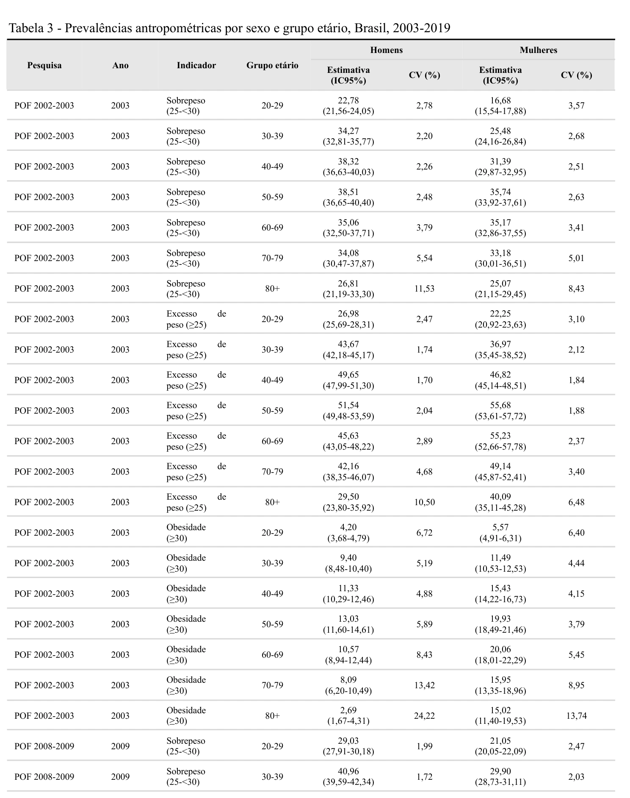
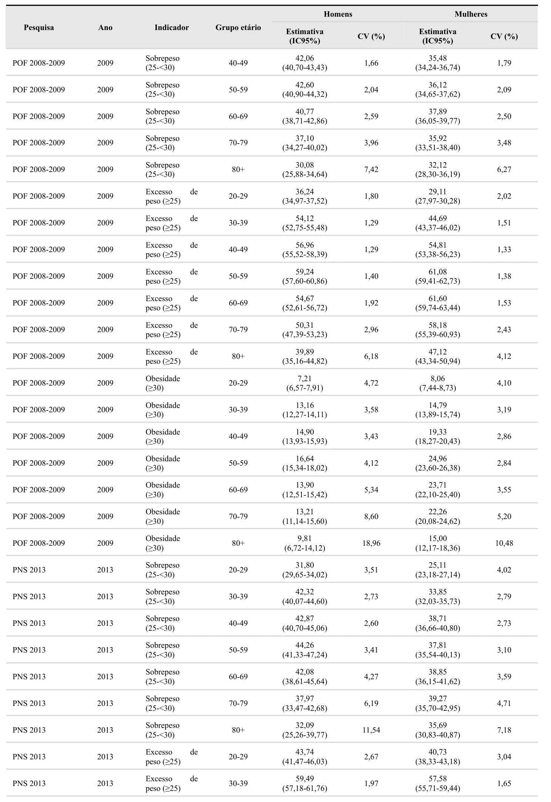
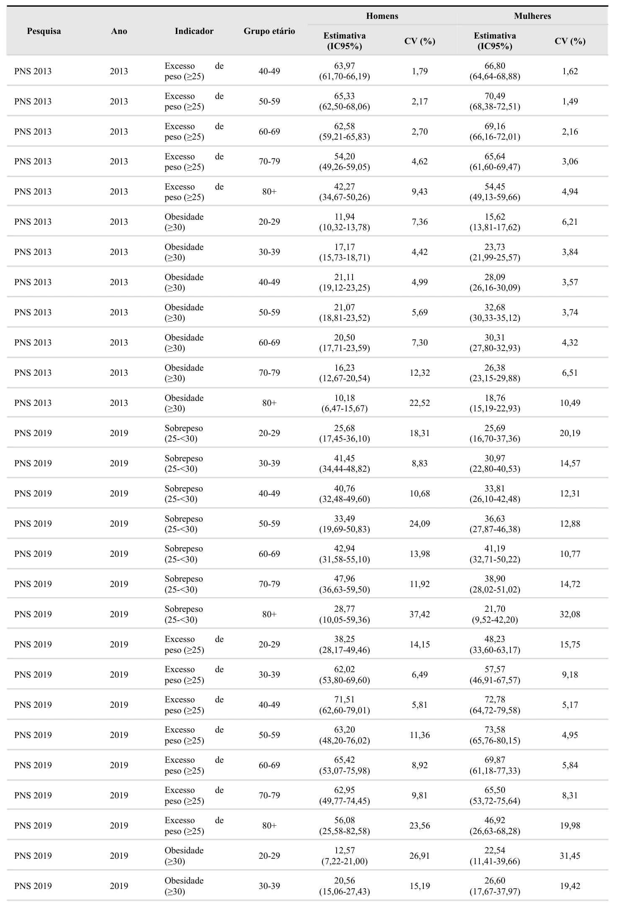
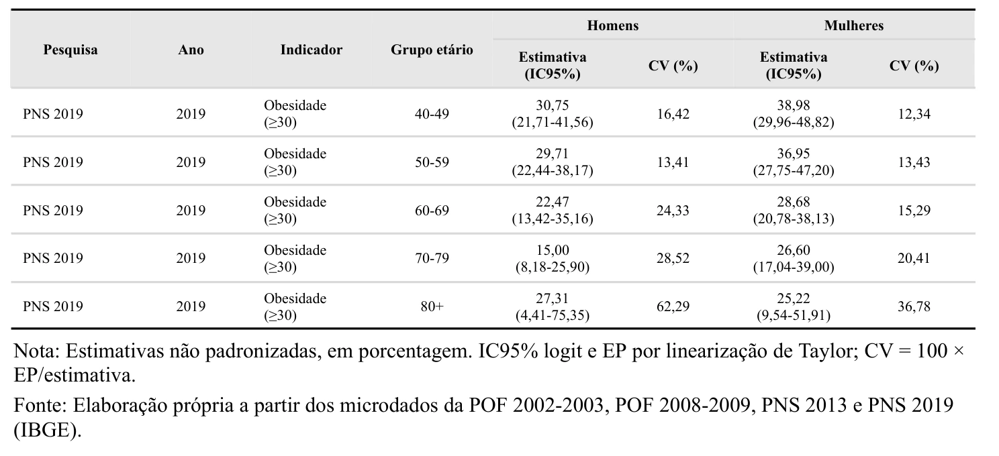
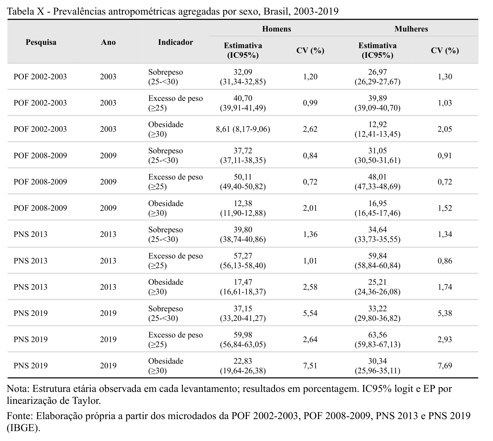
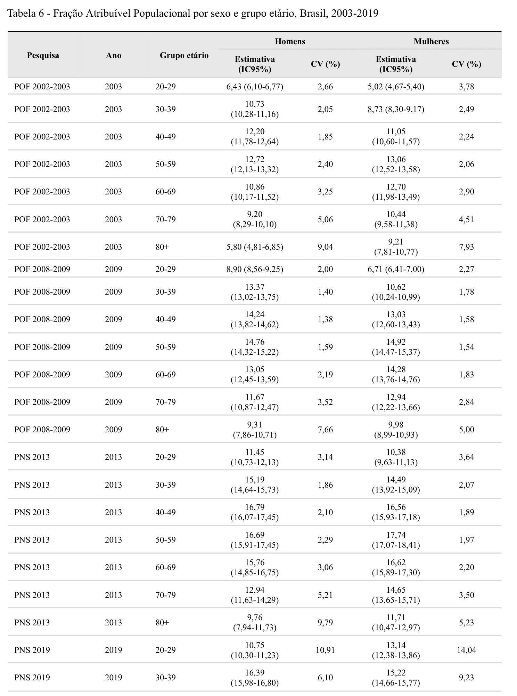
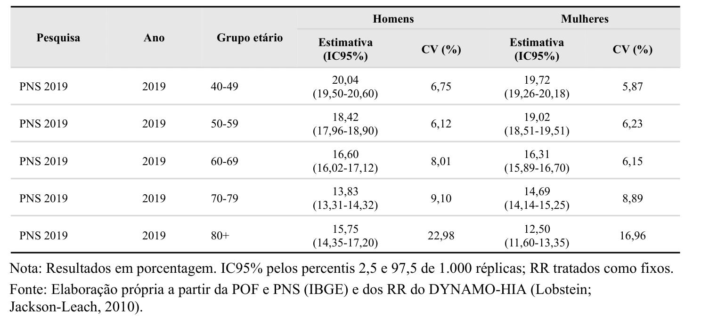
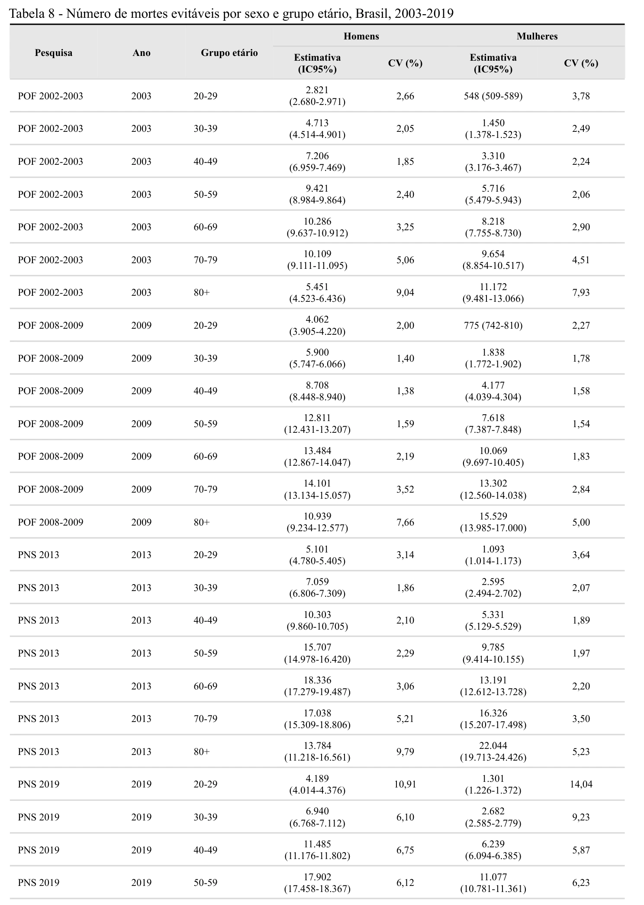
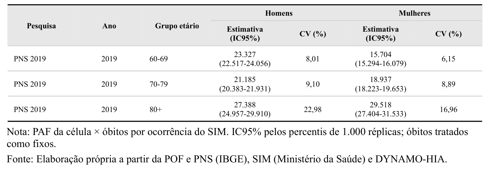

::: {.texto-tcc}

<h2>ANEXO 1: PREVALÊNCIA ANTROPOMÉTRICA POR SEXO E GRUPO ETÁRIO, BRASIL, 2003-2009</h2>

<figure class="reproducao">
  
</figure>

<figure class="reproducao">
  
</figure>

<figure class="reproducao">
  
</figure>

<figure class="reproducao">
  
</figure>

<h2>ANEXO 2: PREVALÊNCIA ANTROPOMÉTRICA AGREGADA POR SEXO, BRASIL 2003-2009</h2>

<figure class="reproducao">
  
</figure>

<h2>ANEXO 3: Fração Atribuível Populacional POR SEXO E GRUPO ETÁRIO, Brasil 2003-2009</h2>

<figure class="reproducao">
  
</figure>

<figure class="reproducao">
  
</figure>

<h2>ANEXO 4: NÚMERO ABSOLUTO DE MORTES ATRIBUÍVEIS À OBESIDADE POR SEXO E GRUPO ETÁRIO NO BRASIL (2003-2009)</h2>

<figure class="reproducao">
  
</figure>

<figure class="reproducao">
  
</figure>

<h2>REFERÊNCIAS</h2>

BRASIL. Ministério da Saúde. Sistema de Informações sobre Mortalidade — SIM. Brasília, DF: Ministério da Saúde. Disponível em: https://www.gov.br/saude/pt-br/composicao/svsa/sistemas-de-informacao/sim. Acesso em: 31 ago. 2026.

IBGE - INSTITUTO BRASILEIRO DE GEOGRAFIA E ESTATÍSTICA. Pesquisa de Orçamentos Familiares 2002-2003: microdados. Rio de Janeiro: IBGE. Disponível em: https://ftp.ibge.gov.br/Orcamentos_Familiares/Pesquisa_de_Orcamentos_Familiares_2002_2003/Microdados/. Acesso em: 31 ago. 2026.

IBGE - INSTITUTO BRASILEIRO DE GEOGRAFIA E ESTATÍSTICA. Pesquisa de Orçamentos Familiares 2008-2009: microdados. Rio de Janeiro: IBGE. Disponível em: https://ftp.ibge.gov.br/Orcamentos_Familiares/Pesquisa_de_Orcamentos_Familiares_2008_2009/Microdados/. Acesso em: 31 ago. 2026.

IBGE - INSTITUTO BRASILEIRO DE GEOGRAFIA E ESTATÍSTICA. Pesquisa Nacional de Saúde 2013: microdados. Rio de Janeiro: IBGE. Disponível em: https://ftp.ibge.gov.br/PNS/2013/Microdados/. Acesso em: 31 ago. 2026.

IBGE - INSTITUTO BRASILEIRO DE GEOGRAFIA E ESTATÍSTICA. Pesquisa Nacional de Saúde 2019: microdados. Rio de Janeiro: IBGE. Disponível em: https://ftp.ibge.gov.br/PNS/2019/Microdados/. Acesso em: 31 ago. 2026.

LOBSTEIN, T.; JACKSON-LEACH, R. Workpackage 7: Overweight and Obesity: report on data collection for overweight and obesity prevalence and related relative risks. London: International Association for the Study of Obesity, 2010.

:::
