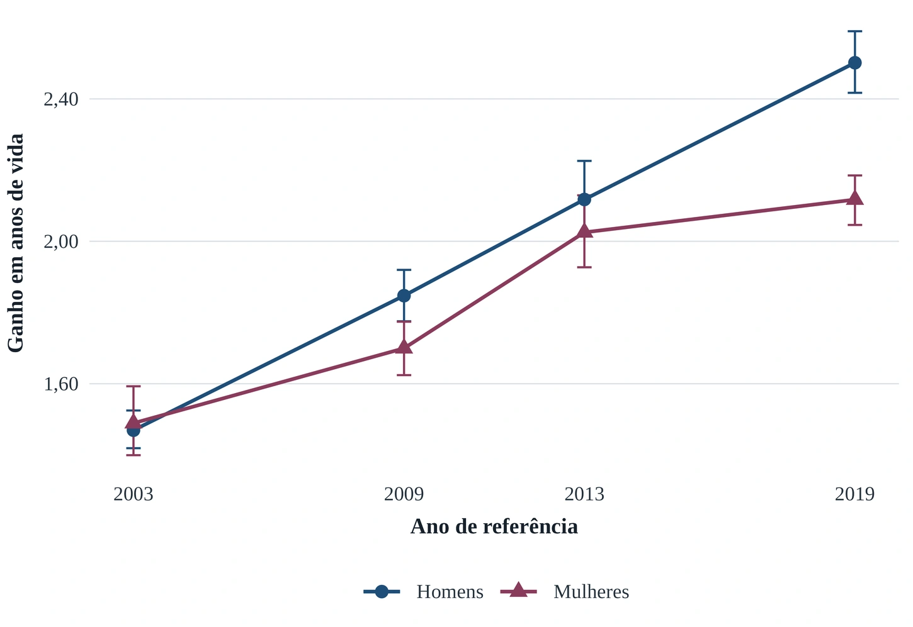

```{=html}
<div class="capa">
  <div class="capa-grade">
    <div class="capa-texto">
      <p class="periodo">Brasil, 2003-2019</p>
      <h1>A obesidade sob uma perspectiva demográfica</h1>
      <p class="subtitulo">Os impactos da composição antropométrica sobre a experiência populacional de mortalidade</p>
    </div>
    <div class="capa-visual">
      
      <dl class="autoria">
        <dt>Autor</dt><dd>Felipe Baeta Casula Pereira</dd>
        <dt>Orientador</dt><dd>Cássio Maldonado Turra</dd>
        <dt>Coorientador</dt><dd>Reinaldo Onofre dos Santos</dd>
      </dl>
    </div>
  </div>
</div>
```

:::: {.acoes}
<a class="acao acao-principal" href="assets/tcc-felipe-casula.pdf" download><i class="bi bi-download" aria-hidden="true"></i> Baixar TCC (PDF)</a>

::: {#apresentacao}
:::
::::

<section class="texto-tcc resumo" lang="pt-BR">
<h2>RESUMO</h2>
<p>Este trabalho analisa a evolução do sobrepeso e da obesidade na população brasileira de 20 anos ou mais e seu impacto sobre a mortalidade populacional entre 2003 e 2019. A abordagem demográfica trata a distribuição da população entre categorias de índice de massa corporal (IMC) como um componente da mortalidade, na medida em que a interação entre essas categorias e fatores como o sexo e a estrutura etária está associada a diferentes níveis de exposição ao risco de morte e a diferentes padrões de sobrevivência. Foram analisados os microdados das Pesquisas de Orçamentos Familiares de 2002-2003 e 2008-2009 e das Pesquisas Nacionais de Saúde de 2013 e 2019, considerando-se os desenhos amostrais e adotando-se a população brasileira de 2019 como referência para a padronização etária. As prevalências foram combinadas com tábuas de mortalidade do IBGE, registros de óbitos do Sistema de Informações sobre Mortalidade e riscos relativos do projeto DYNAMO-HIA. Em um cenário contrafactual sem excesso de peso, definido como IMC ≥ 25 kg/m², foram estimados as frações atribuíveis populacionais, os óbitos atribuíveis à obesidade e os potenciais ganhos em expectativa de vida aos 20 anos. Entre 2003 e 2019, a prevalência padronizada de obesidade aumentou de 9,0% para 22,3% entre os homens e de 13,6% para 29,9% entre as mulheres. No mesmo período, o ganho potencial em expectativa de vida passou de 1,47 para 2,50 anos entre os homens e de 1,49 para 2,12 anos entre as mulheres. Os resultados mostram que a maior prevalência de obesidade entre as mulheres não se traduziu em ganhos contrafactuais sistematicamente maiores, em consonância com a literatura sobre o “paradoxo de gênero” em saúde e mortalidade, caracterizado por maior morbidade relativa entre as mulheres e maior mortalidade relativa entre os homens.</p>
<p class="palavras-chave">Palavras-chave: obesidade; mortalidade; demografia; brasil.</p>
</section>

<section class="texto-tcc resumo" lang="en">
<h2>ABSTRACT</h2>
<p>This study examines trends in overweight and obesity among Brazilians aged 20 years and older and their impact on population mortality between 2003 and 2019. The demographic approach treats the distribution of the population across body mass index (BMI) categories as a component of mortality, as the interaction between these categories and factors such as sex and age structure is associated with differences in mortality risk and survival patterns. Microdata from the 2002-2003 and 2008-2009 Household Budget Surveys and the 2013 and 2019 National Health Surveys were analyzed, accounting for the survey designs and using the 2019 Brazilian population as the reference for age standardization. Prevalence estimates were combined with life tables from the Brazilian Institute of Geography and Statistics (IBGE), death records from the Mortality Information System, and relative risks from the DYNAMO-HIA project. Under a counterfactual scenario in which no one had a BMI of 25 kg/m² or higher, population attributable fractions, deaths attributable to obesity, and potential gains in life expectancy at age 20 were estimated. Between 2003 and 2019, the age-standardized prevalence of obesity increased from 9.0% to 22.3% among men and from 13.6% to 29.9% among women. Over the same period, the potential gain in life expectancy increased from 1.47 to 2.50 years among men and from 1.49 to 2.12 years among women. The higher prevalence of obesity among women did not translate into consistently greater counterfactual gains. This finding is consistent with the literature on the “gender paradox” in health and mortality, characterized by higher morbidity among women and higher mortality among men.</p>
<p class="palavras-chave">Keywords: obesity; mortality; demography; brazil.</p>
</section>
