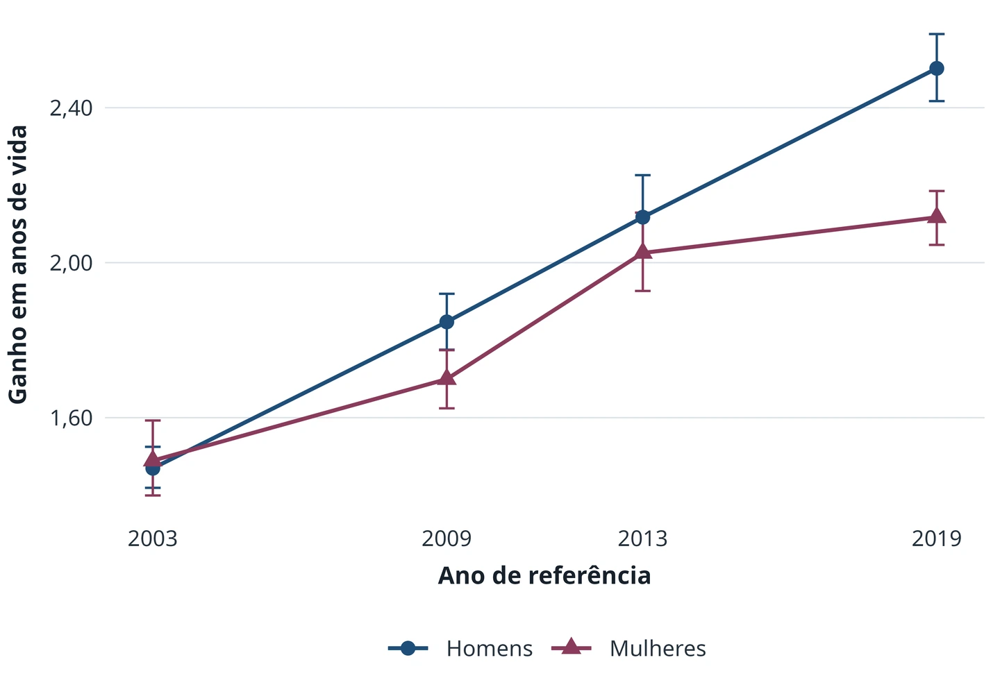
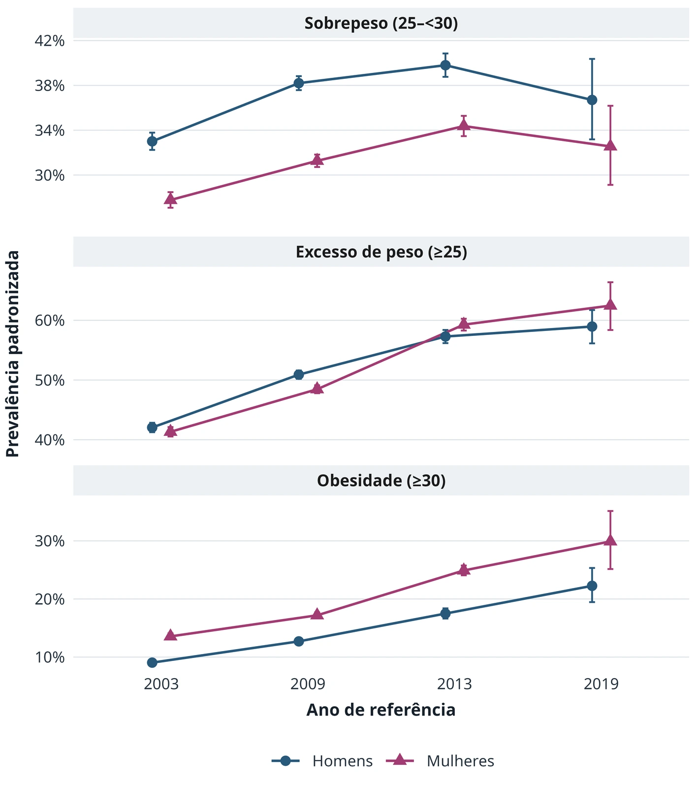
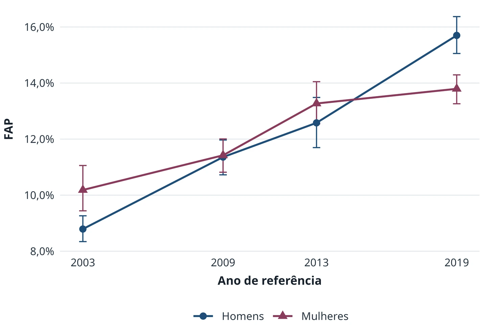
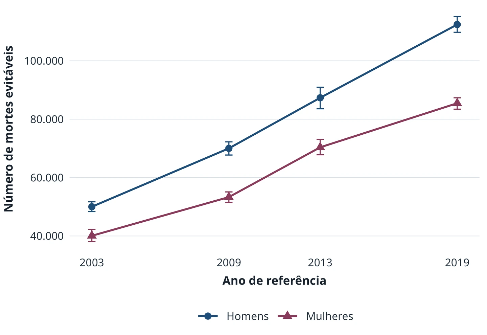

:::::: {.abertura}
::::: {.abertura-texto}

[Universidade Federal de Minas Gerais]{.universidade}

# A obesidade sob uma perspectiva demográfica

::: {.subtitulo}
Os impactos da composição antropométrica sobre a experiência populacional de mortalidade
:::

::: {.autoria}
**Felipe Casula**  
Curso de Graduação em Ciências Sociais · 2026
:::

:::: {.acoes}
<a class="acao acao-principal" href="assets/tcc-felipe-casula.pdf" download><i class="bi bi-download" aria-hidden="true"></i> Baixar TCC (PDF)</a>

::: {#apresentacao}
:::
::::
:::::

::::: {.abertura-visual}
<figure class="grafico-destaque">
  <figcaption>
    Brasil, 2003-2019
    Evolução do potencial ganho em expectativa de vida aos 20 anos
  </figcaption>
  
  <small class="grafico-nota">Nota: Cenário de eliminação do IMC ≥25 kg/m²; IC95% bootstrap. Fonte: IBGE, POF e PNS; IBGE, Tábuas Completas de Mortalidade; DYNAMO-HIA (Lobstein; Jackson-Leach, 2010). Elaboração própria.</small>
</figure>
:::::
::::::

:::: {.leitura .leitura-resumo}
## Resumo {#resumo}

Este trabalho analisa a evolução do sobrepeso e da obesidade na população brasileira de 20 anos ou mais e seu impacto sobre a mortalidade populacional entre 2003 e 2019. A abordagem demográfica trata a distribuição da população entre categorias de índice de massa corporal (IMC) como um componente da mortalidade, na medida em que a interação entre essas categorias e fatores como o sexo e a estrutura etária está associada a diferentes níveis de exposição ao risco de morte e a diferentes padrões de sobrevivência. Foram analisados os microdados das Pesquisas de Orçamentos Familiares de 2002-2003 e 2008-2009 e das Pesquisas Nacionais de Saúde de 2013 e 2019, considerando-se os desenhos amostrais e adotando-se a população brasileira de 2019 como referência para a padronização etária. As prevalências foram combinadas com tábuas de mortalidade do IBGE, registros de óbitos do Sistema de Informações sobre Mortalidade e riscos relativos do projeto DYNAMO-HIA. Em um cenário contrafactual sem excesso de peso, definido como IMC ≥ 25 kg/m², foram estimados as frações atribuíveis populacionais, os óbitos atribuíveis à obesidade e os potenciais ganhos em expectativa de vida aos 20 anos. Entre 2003 e 2019, a prevalência padronizada de obesidade aumentou de 9,0% para 22,3% entre os homens e de 13,6% para 29,9% entre as mulheres. No mesmo período, o ganho potencial em expectativa de vida passou de 1,47 para 2,50 anos entre os homens e de 1,49 para 2,12 anos entre as mulheres. Os resultados mostram que a maior prevalência de obesidade entre as mulheres não se traduziu em ganhos contrafactuais sistematicamente maiores, em consonância com a literatura sobre o “paradoxo de gênero” em saúde e mortalidade, caracterizado por maior morbidade relativa entre as mulheres e maior mortalidade relativa entre os homens.

[Palavras-chave: obesidade; mortalidade; demografia; brasil.]{.palavras-chave}
::::

:::: {.leitura}
## Introdução {#introducao}

O aumento da prevalência de sobrepeso e obesidade é um fenômeno global e traz consigo diversos desdobramentos na morbimortalidade das populações. Diante disso, o presente trabalho buscou estimar qual o impacto da obesidade sob os indicadores demográficos de mortalidade no Brasil entre os anos 2003 e 2019. Para realizar este objetivo, foi utilizada uma aplicação metodológica inaugurada por Preston e Stokes (2011), na qual se relacionam três tipos de fontes de dados: estimações de prevalência antropométrica para a população, tábuas de vida oficiais e parâmetros de Risco Relativo (RR) oriundos de estudos prospectivos. A partir dessas fontes de dados, a metodologia do autor calcula as Frações Atribuíveis Populacionais (FAP), que representa, para os fins desta análise, a fração do risco de mortalidade (e das mortes) atrelados à obesidade. Em seguida, a FAP é utilizada para construir uma tábua de vida contrafactual correspondente a um cenário hipotético no qual a obesidade se mostra completamente ausente. A comparação entre a tábua de vida oficial e a contrafactual nos permite estimar o impacto da obesidade sobre indicadores como expectativa de vida.

### Revisão bibliográfica {#revisao}

Um próximo avanço significativo ocorre com o trabalho de Preston e Stokes (2011), no qual os autores utilizam os mesmos três tipos de fontes de dados (tábuas de vida, inquéritos representativos com dados de altura e peso e estudos longitudinais de saúde) para estimar as Frações Atribuíveis Populacionais (FAP) e os Possíveis Ganhos em Expectativa de Vida (PGEV) para diferentes países de alta renda no ano de 2006. A FAP, no contexto adotado por Preston e Stokes, pressupõe que as TEM sejam uma média ponderada das TEM de cada grupo de IMC contido no intervalo etário, sendo as prevalências antropométricas o fator de ponderação. Uma das formas de explicar o procedimento metodológico adotado é dizendo que os autores criaram TEM contrafactuais (TEM*), movendo toda a população para o grupo antropométrico de referência (associados à menor risco de mortalidade). A FAP é, nesse contexto, igual a: 1-(TEM*/TEM), ou seja, a fração do risco de mortalidade atribuível à obesidade. Tendo como base as medidas contrafactuais de risco estimadas, os autores construíram tábuas de vida que representavam um cenário de mortalidade na ausência de obesidade. Nesse sentido, os “Possíveis Ganhos em Expectativa de Vida” correspondem à diferença entre as expectativas de vida das tábuas oficiais e das tábuas contrafactuais.
::::

:::: {.leitura}
## Metodologia {#metodologia}

A metodologia aplicada está dividida em dois blocos, o primeiro voltado à análises inferenciais de prevalência; e o segundo, à análises contrafactuais acerca da intercessão entre obesidade e experiência populacional de mortalidade. Para as análises de prevalência, foram utilizados os inquéritos de representatividade nacional: POF 2002-2003, POF 2008-2009, PNS 2013 e PNS 2019, somado à estimação de população por sexo e grupo etário para o ano de 2019 do IBGE (revisão 2024), utilizada para padronização etária dos resultados. Para as análises contrafactuais, foram utilizados os inquéritos acima mencionados somados aos: dados de mortalidade por sexo e grupo etário extraídos do Sistema de Informação sobre Mortalidade (SIM); tabuas de vida do IBGE; e medidas de risco relativos por grupo de IMC, grupo etário e sexo extraídos do relatório do projeto DYNAMO-HIA elaborado por Lobstein e Jackson-Leach (2010).
::::

:::::: {.resultados}
## Resultados {#resultados}

::::: {.resultado}
:::: {.resultado-texto}
### Prevalências antropométricas {#prevalencias}

Em nível populacional, as prevalências totais estimadas são médias ponderadas dos resultados de cada grupo etário, considerando-se a estrutura etária. Como visto anteriormente, existem diversas relações entre idade e prevalências antropométricas. Por esse motivo, padronizamos os resultados utilizando como referência a estrutura etária da população brasileira de 2019, o que possibilita maior comparabilidade entre os anos.

A prevalência de obesidade entre as mulheres passou de 13,6% (13,0-14,1) em 2003 para 29,9% (25,2-35,1) em 2019, totalizando aumento de aproximadamente 120% nas estimativas pontuais. Para os homens, a prevalência passou de 9,0% (8,6-9,5) em 2003 para 22,3% (19,5-25,3) em 2019, o que corresponde a aumento de aproximadamente 148% nas estimativas pontuais.
::::

<figure class="resultado-figura">
  
  <figcaption>
    Evolução das prevalências antropométricas padronizadas por idade
    <small class="grafico-nota">Nota: Padrão formado pela população brasileira de ambos os sexos em 2019; padronização direta com survey::svystandardize(). Fonte: IBGE, POF 2002-2003 e 2008-2009; IBGE, PNS 2013 e 2019; IBGE, Projeções da População, revisão 2024. Elaboração própria.</small>
  </figcaption>
</figure>
:::::

::::: {.resultado}
:::: {.resultado-texto}
### Análise contrafactual {#analise-contrafactual}

Os resultados contrafactuais aqui estimados exigem um alto grau de cuidado interpretativo, pois estão intrinsecamente atrelados a uma série de pressupostos e limitações. Apesar de termos uma coerência metodológica em aplicar diferentes valores de RR para homens e mulheres, considerando também os grupos etários, as medidas de RR utilizadas remetem ao ano de 2007, e as pesquisas que originaram esses parâmetros foram todas conduzidas em contextos não brasileiros (Lobstein e Jackson-Leach, 2010).

#### Fração atribuível populacional {#fap}

Para interpretar a FAP por grupo etário, deve-se considerar os elementos por trás dessa medida: os Riscos Relativos e as prevalências antropométricas. A desigualdade na exposição aos riscos de mortalidade entre os grupos antropométricos, conforme apresentado (Tabela 2), reduz nas idades mais avançadas, e também estão relacionadas a uma maior penalidade para os grupos masculinos, a prevalência de sobrepeso aos homens, ao passo que a prevalência de obesidade esteve mais associado às mulheres, e o diferencial entre os sexos para excesso de peso mostrou uma inversão a partir dos grupos etários acima de 50 anos, passando a penalizar mais as mulheres. Esses foram os elementos responsáveis pela diferença de sexo por trás da estimação da FAP. No que se refere a evolução do indicador para cada sexo ao longo do período observado, ela simplesmente reflete o aumento da prevalência para os grupos de sobrepeso e obesidade, visto que os valores de RR aplicados foram os mesmos para todos os anos.
::::

<figure class="resultado-figura">
  
  <figcaption>
    Evolução da Fração Atribuível Populacional sintética
    <small class="grafico-nota">Nota: Ponderação pela distribuição de óbitos ndₓ da tábua de vida de cada ano; IC95% bootstrap. Fonte: IBGE, POF e PNS; IBGE, Tábuas Completas de Mortalidade; DYNAMO-HIA (Lobstein; Jackson-Leach, 2010). Elaboração própria.</small>
  </figcaption>
</figure>
:::::

::::: {.resultado}
:::: {.resultado-texto}
### Número de mortes evitáveis {#mortes-evitaveis}

O número absoluto de mortes evitáveis, ou de mortes associadas à obesidade, como descrito na seção metodológica, foi mensurado a partir da multiplicação da FAP pelo número de mortes registradas dentro de um respectivo grupo etário. Ou seja, esse indicador relaciona as prevalências antropométricas e correspondentes riscos específicos (captados pela FAP) com o padrão da curva de mortalidade. Por essa razão, os resultados são maiores para os grupos masculinos em todos os períodos analisados, visto que as maiores FAPs “coincidem” com os momentos mais acentuados da curva de mortalidade masculina.
::::

<figure class="resultado-figura">
  
  <figcaption>
    Evolução do número absoluto de mortes evitáveis
    <small class="grafico-nota">Nota: População de 20 anos ou mais; IC95% bootstrap. Fonte: IBGE, POF e PNS; SIM, óbitos por ocorrência; DYNAMO-HIA (Lobstein; Jackson-Leach, 2010). Elaboração própria.</small>
  </figcaption>
</figure>
:::::
::::::

:::: {.leitura}
## Conclusão {#conclusao}

A obesidade é um tema central no debate contemporâneo sobre saúde e mortalidade. Sua acentuada dinâmica transformativa nas últimas décadas, assim como seus impactos na morbi-mortalidade, exigem objetividade analítica e profundidade teórica. Apreender a "obesidade" apenas em sua expressão superficial limita, entre outras coisas, os horizontes transformativos possíveis. Ao longo do desenvolvimento conceitual, apresentamos três aspectos do fenômeno: fisiológicos, populacionais e socioambientais. O presente trabalho se dedicou de forma praticamente integral aos aspectos "populacionais", contribuindo, assim, para uma sistematização formal e para uma mensuração estatística referente ao contexto brasileiro entre 2003 a 2019.

A investigação conduzida tratou fundamentalmente dos aspectos dinâmico-quantitativos da interseção obesidade/mortalidade. Por trás dos resultados aferidos, e de suas respectivas evoluções em termos de grandeza no tempo, há um conteúdo qualitativo relacionado às práticas em geral e as dinâmicas de produção e consumo (produção e distribuição da riqueza socialmente produzida). O estudo desses aspectos sociais - que se desdobram no mundo, e acabam por emergir nas abstrações populacionais - é incontornável para àqueles(as) que busquem compreender o fenômeno e seus horizontes possíveis.
::::

::: {.creditos}
**Felipe Casula** · Universidade Federal de Minas Gerais

Orientador: Cássio Maldonado Turra  
Coorientador: Reinaldo Onofre dos Santos
:::
