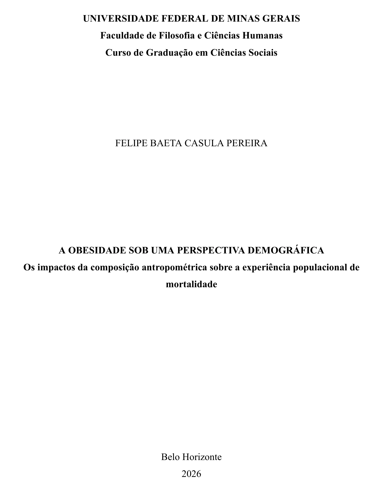
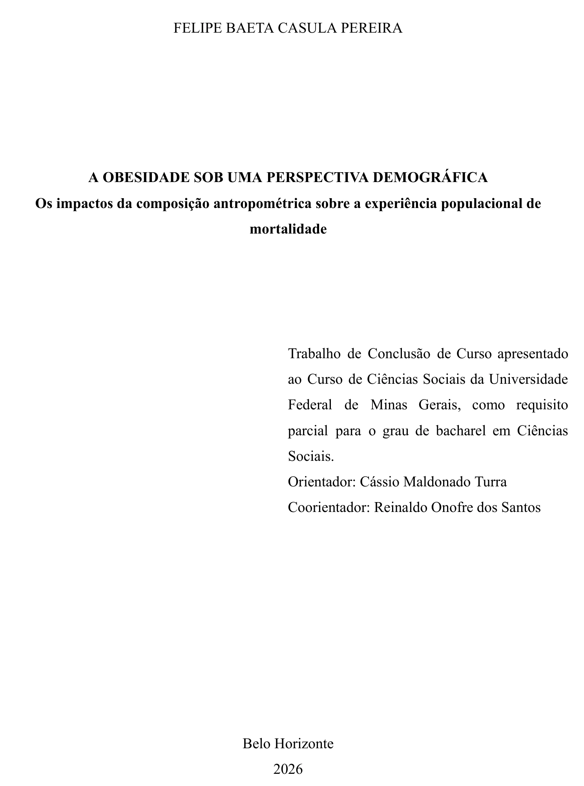
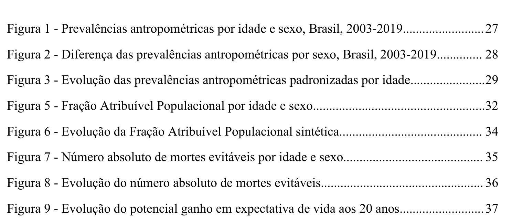
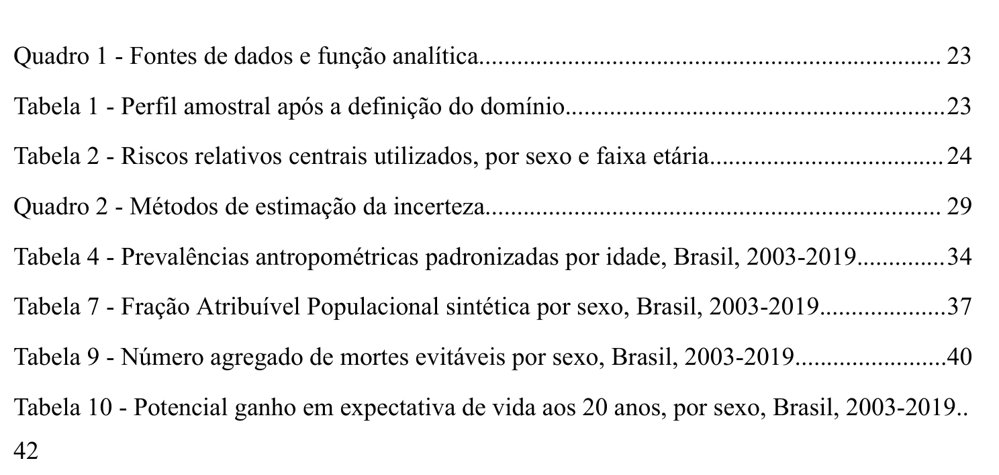
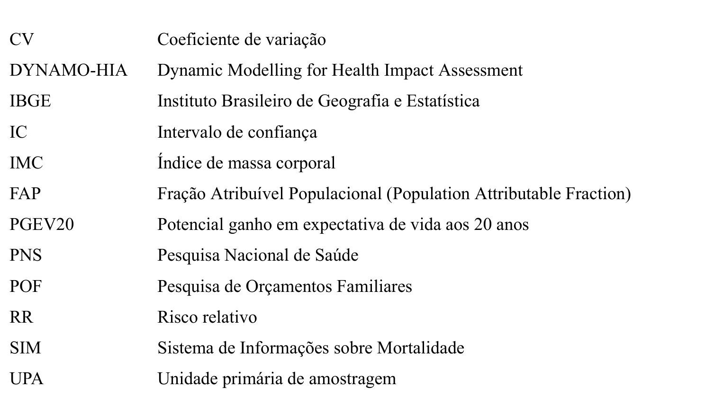
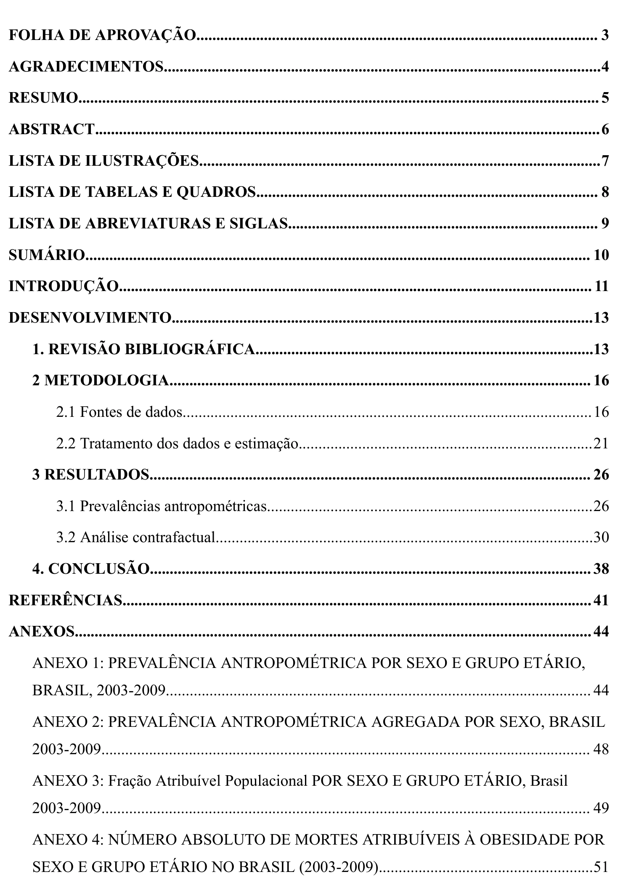
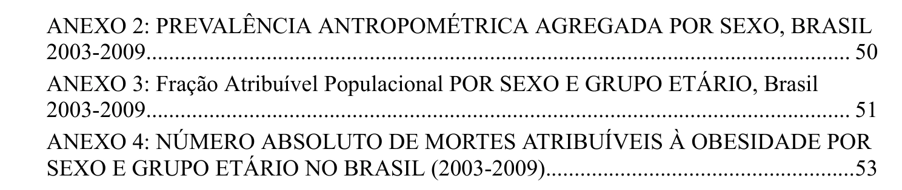

::: {.texto-tcc}

<h2 id="pre-textual-1">CAPA</h2>

<figure class="reproducao">
  
</figure>

<h2 id="pre-textual-2">FOLHA DE ROSTO</h2>

<figure class="reproducao">
  
</figure>

<h2 id="pre-textual-3">FOLHA DE APROVAÇÃO</h2>

<h2 id="pre-textual-7">LISTA DE ILUSTRAÇÕES</h2>

<figure class="reproducao">
  
</figure>

<h2 id="pre-textual-8">LISTA DE TABELAS E QUADROS</h2>

<figure class="reproducao">
  
</figure>

<h2 id="pre-textual-9">LISTA DE ABREVIATURAS E SIGLAS</h2>

<figure class="reproducao">
  
</figure>

<h2 id="pre-textual-10">SUMÁRIO</h2>

<figure class="reproducao">
  
</figure>

<figure class="reproducao">
  
</figure>

:::
