::: {.texto-tcc}

A metodologia proposta se encontra alinhada ao desenvolvimento conceitual anteriormente apresentado, no qual a &quot;obesidade&quot;, do ponto de vista populacional, pode ser pensada como: um efeito de composição associado à exposição desigual à riscos específicos de mortalidade. Medidas antropométricas baseadas no Índice de Massa Corporal (IMC) são, atualmente, a forma mais viável de categorização dos indivíduos segundo os grupos delimitados pela literatura. Para além da ampla comparabilidade histórica que essa métrica possibilita, ela será utilizada aqui como instrumento de &quot;importação de desigualdades observadas&quot; por estudos prospectivos internacionais (Global BMI Mortality Collaboration et al., 2016; Rabacow, 2019; Lobstein e Jackson-Leach, 2010). A metodologia aplicada está dividida em dois blocos, o primeiro voltado à análises inferenciais de prevalência; e o segundo, à análises contrafactuais acerca da intercessão entre obesidade e experiência populacional de mortalidade. Para as análises de prevalência, foram utilizados os inquéritos de representatividade nacional: POF 2002-2003, POF 2008-2009,  PNS 2013 e PNS 2019, somado à estimação de população por sexo e grupo etário para o ano de 2019 do IBGE (revisão 2024), utilizada para padronização etária dos resultados. Para as análises contrafactuais, foram utilizados os inquéritos acima mencionados somados aos: dados de mortalidade por sexo e grupo etário extraídos do Sistema de Informação sobre Mortalidade (SIM); tabuas de vida do IBGE; e medidas de risco relativos por grupo de IMC, grupo etário e sexo extraídos do relatório do projeto DYNAMO-HIA elaborado por Lobstein e Jackson-Leach (2010). Os indicadores estimados no presente trabalho são, respectivamente: 1. prevalência de sobrepeso e obesidade por sexo e grupo etário 2. prevalência de sobrepeso e obesidade por sexo para cada ano de refência (resultado observado e padronizado pela estrutura etária brasileira 2019) 3. Frações atribuíveis populacionais (FAP) por sexo e grupo etário 4. FAP sintética por sexo 5. Número absoluto de mortes associadas à obesidade 6. Potenciais Ganhos em Expectativa de Vida para idade de 20 anos (PGEV20). Abaixo será discutido, primeiramente, as fontes de dados, e, em seguida, a respectiva metodologia aplicada para a aferição de cada resultado.

<h2>2.1 Fontes de dados</h2>

<h3>2.1.1 Pesquisas de Orçamentos Familiares</h3>

As POF são inquéritos domiciliares nacionais do IBGE voltadas para o estudo dos padrões e condições de vida das famílias no Brasil. Nas edições de 2002-2003 e 2008-2009 da pesquisa, foram aferidos diferente as medidas de peso e altura para um dos indivíduos adultos residentes no domicílio selecionado1. As pesquisas adotaram amostragem complexa por conglomerados em dois estágios, com estratificação geográfica e estatística: setores censitários constituíram as unidades primárias, e os domicílios, as unidades de segundo estágio. A análise utilizou os fatores finais de expansão fornecidos pelo IBGE. Na POF 2002-2003, a UPA foi reconstruída pela combinação de Unidade da Federação, sequencial do setor e dígito verificador, e o estrato foi tornado nacionalmente único mediante concatenação com a UF. Na POF 2008-2009, o código de UPA já estava disponível e o estrato também foi concatenado à UF.

As medidas antropométricas utilizadas nos microdados das POF são as versões imputadas pelo IBGE. Gestantes foram excluídas em 2008-2009 quando identificáveis. Na edição 2002-2003, o arquivo disponível não contém um indicador capaz de excluir diretamente todas as gestantes; essa diferença de mensuração foi conservada como limitação de comparabilidade.

<h3>2.1.2 Pesquisas Nacionais de Saúde</h3>

A PNS é um inquérito domiciliar de abrangência nacional ligado ao Sistema Integrado de Pesquisas Domiciliares. O desenho possui estratificação das unidades primárias e três estágios de seleção: UPA, domicílio e um morador elegível. Na PNS 2013, o morador selecionado tinha 18 anos ou mais; em 2019, a elegibilidade começou aos 15 anos. Os pesos finais combinam o inverso das probabilidades de seleção, correção de não resposta e calibração para totais populacionais conhecidos (Souza-Júnior et al., 2015; Stopa et al., 2020).

Na PNS de 2019, as mensurações de altura e peso deixaram de ser feitas para todos os moradores selecionados, e passaram a ser coletadas apenas em uma subamostra. Com isso, a amostra efetiva para os domínios estudados neste trabalho é de 57.194 observações em 2013 e cai para 6.418 em 2019. Essa mudança prejudicou a consistência e a precisão dos resultados estimados para o ano de 2019, sobretudo para o grupo de homens com idade mais avançada. Com essa mudança, o peso calibrado utilizado na declaração do objeto amostral é &quot;V00291&quot; (morador selecionado) para 2013, e &quot;V00301&quot; (peso antropométrico calibrado) para 2019.

1 A pesquisa também conta com um módulo dedicado ao estudo da antropometria de crianças de adolescentes. Contudo, para os fins das análises aqui desenvolvidas, estamos utilizando exclusivamente as aferições antropométricas para os adultos.

<h3>2.1.3 Projeções populacionais e tábuas de vida do IBGE</h3>

As Projeções da População, revisão 2024, forneceram a população brasileira por idade simples e ambos os sexos em 2019, transformada em pesos etários comuns para a padronização direta das prevalências mensuradas. As Tábuas Completas de Mortalidade forneceram as funções de mortalidade e sobrevivência de cada ano e sexo, posteriormente agregadas aos sete intervalos decenais. As funções da tábua de vida foram utilizadas para criação das tábuas de vida contrafactuais (cenário sem obesidade). A função de densidade &quot;dx&quot; também foi utilizada como fator de ponderação para estimar a PAF sintética.

<h3>2.1.4 Sistema de Informações sobre Mortalidade</h3>

As contagens absolutas de óbitos foram extraídas do portal do SIM. Foram selecionados óbitos por ocorrência no Brasil, por sexo e grupos etários compatíveis, nos anos de 2003, 2009, 2013 e 2019. Registros de sexo ignorado - 108, 61, 116 e 76, respectivamente - não foram redistribuídos. A utilização de ocorrência, e não residência, deve permanecer idêntica em todas as ondas para preservar a comparabilidade interna (BRASIL, Ministério da Saúde, 2026).

<h3>2.1.5 Riscos relativos externos</h3>

Os riscos relativos de mortalidade por todas-as-causas foram extraídos do relatório do projeto DYNAMO-HIA elaborado por Lobstein e Jackson-Leach (2010). A fonte apresenta parâmetros centrais distintos por sexo, categoria de IMC e faixa etária. Para homens de 20-49 anos, os RR-base foram 1,20 para IMC de 25 a menos de 30 e 1,55 para IMC igual ou superior a 30; para mulheres, 1,15 e 1,50, respectivamente. A categoria IMC menor que 25 recebeu RR igual a 1. O excesso de risco foi reduzido por fatores etários de 1,00 para 20-49 anos, 0,98 para 50-59, 0,95 para 60-69 e 0,90 para 70 anos ou mais. As faixas de 20-29, 30-39 e 40-49 anos foram associadas ao estrato 20-49 da fonte; 70-79 e 80 anos ou mais foram associadas ao estrato 70+. Somente as medidas centrais foram utilizadas. A incerteza dos RR não foi propagada.

A fórmula, importada de Lobstein, para o cálculo do RR considerando sexo, grupo etário e grupo de IMC é:

<figure class="reproducao">
  <a href="assets/documento/equacao-1.webp">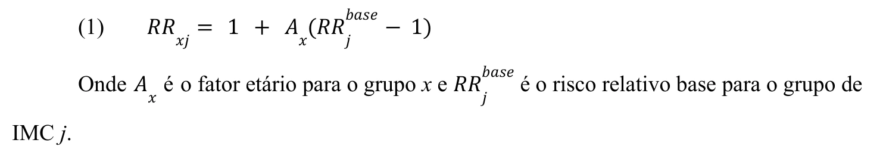</a>
</figure>

<figure class="reproducao">
  <a href="assets/documento/quadro-1.webp">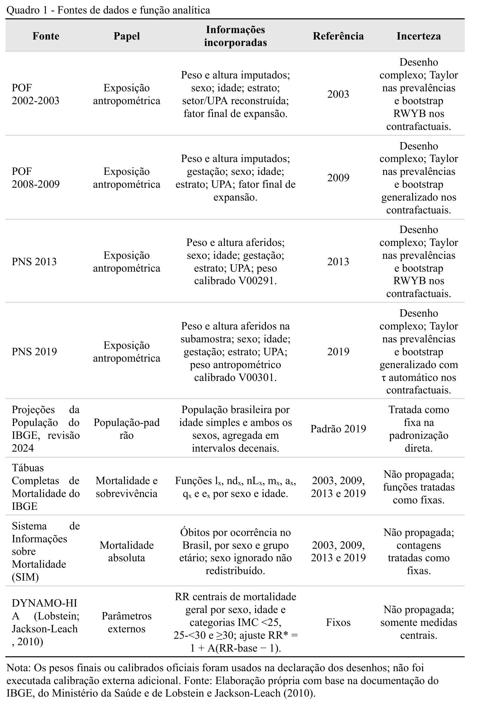</a>
</figure>

<figure class="reproducao">
  <a href="assets/documento/tabela-1.webp">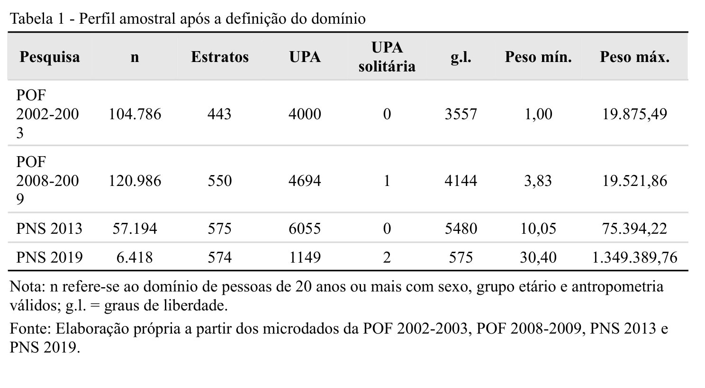</a>
</figure>

<figure class="reproducao">
  <a href="assets/documento/tabela-2.webp">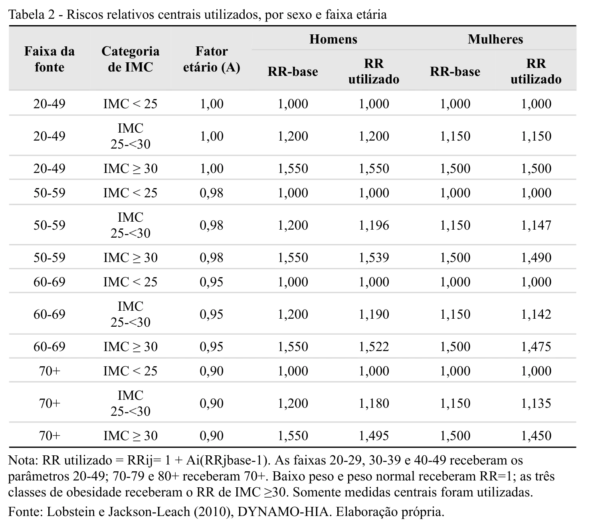</a>
</figure>

<h2>2.2 Tratamento dos dados e estimação</h2>

<h3>2.2.1 Classificação antropométrica</h3>

O índice de massa corporal foi calculado pela divisão do peso em quilogramas pelo quadrado da altura em metros. Foram considerados antropometricamente válidos os registros com peso e altura positivos e finitos, IMC de 15,0 a menos de 60,0 kg/m² e ausência de gestação quando essa informação estava disponível.

Na descrição das prevalências foram estimados três indicadores binários: sobrepeso, definido por 25,0 ≤ IMC &lt; 30,0 kg/m²; excesso de peso, definido por IMC ≥ 25,0 kg/m²; e obesidade, definida por IMC ≥ 30,0 kg/m², sem discriminação de grau. Sobrepeso e obesidade são categorias mutuamente exclusivas, enquanto o excesso de peso inclui todas as pessoas com sobrepeso ou obesidade.

Para os indicadores contrafactuais, a distribuição amostral foi mantida em seis categorias mutuamente exclusivas: baixo peso (&lt;18,5), peso normal (18,5-&lt;25), sobrepeso (25-&lt;30), obesidade grau I (30-&lt;35), grau II (35-&lt;40) e grau III (≥40 kg/m²). Como a fonte externa distingue apenas IMC &lt;25, 25-&lt;30 e ≥30, baixo peso e peso normal receberam RR igual a 1, e os três graus de obesidade receberam o mesmo RR de IMC ≥30. As seis parcelas foram preservadas para documentar integralmente a composição amostral, embora não exista gradiente de RR entre os graus de obesidade na parametrização utilizada2.

<h3>2.2.2 Declaração dos desenhos amostrais</h3>

Cada levantamento foi declarado, antes do recorte analítico, como objeto survey por meio de <em>svydesign()</em>, informando UPA, estrato, peso final ou calibrado oficial e <em>nest=TRUE</em>. Em seguida, a população de 20 anos ou mais, com sexo, grupo etário e antropometria válidos, foi delimitada com <em>subset()</em>, isto é, como análise de domínio. Essa ordem preserva a estrutura necessária à estimação correta das variâncias. Não foi realizada uma nova calibração externa: a calibração e os ajustes de não resposta já incorporados nos pesos oficiais foram mantidos. UPA solitárias foram tratadas com <em>survey.lonely.psu=’adjust’</em> e o ajuste foi estendido aos domínios (Lumley, 2004, 2010; Silva; Dias, 2020).

<h3>2.2.3 Prevalências e precisão</h3>

Em cada pesquisa, as prevalências foram estimadas por sexo e grupo etário e de forma agregada por sexo. A variância foi obtida por linearização de Taylor no desenho complexo.

2 Optamos por essa decisão pois, futuramente, o procedimento aqui empregado pode ser replicado utilizando outras medidas de RR mais detalhadas por grupos de IMC.

Os intervalos de 95% de confiança foram construídos pela transformação logit com <em>survey::svyciprop(method=&#x27;logit&#x27;)</em>, o que mantém os limites entre zero e um. A precisão relativa foi resumida pelo coeficiente de variação.

Fórmula utilizada para a estimação da prevalência considerando o contexto amostral calibrado:

<figure class="reproducao">
  <a href="assets/documento/equacoes-2-3.webp">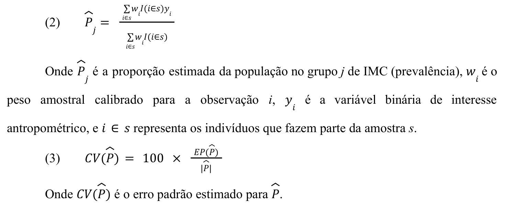</a>
</figure>

<h3>2.2.4 Padronização etária</h3>

Visto que há uma relação observada entre prevalência antropométrica e idade, padronizamos os resultados estimados a fim de permitir comparabilidade entre os períodos. Para todos os ano aferidos, utilizamos a estrutura etária estimada para o ano de 2019:

<figure class="reproducao">
  <a href="assets/documento/equacao-4.webp">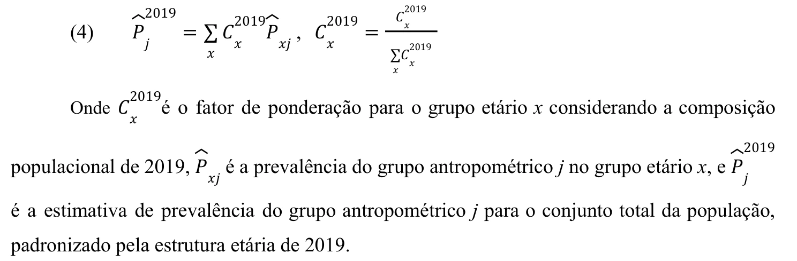</a>
</figure>

Para a padronização direta, foi utilizada a estrutura etária da população brasileira de ambos os sexos em 2019. O mesmo vetor de pesos etários foi aplicado às estimativas de homens e mulheres em todos os períodos analisados. Assim, as diferenças entre as prevalências padronizadas por sexo não refletem diferenças entre as estruturas etárias masculina e feminina, mas diferenças nas prevalências específicas por idade. A padronização foi executada diretamente nos objetos de desenho amostral por meio da função <em>survey::svystandardize()</em>, utilizando-se <em>by = ~faixa_idade </em>e <em>over = ~sexo</em>. Em seguida, as prevalências padronizadas, os erros-padrão e os intervalos de confiança de 95%, com transformação logit, foram estimados com <em>survey::svyciprop() </em>no desenho padronizado.

<h3>2.2.5 Fração atribuível populacional, FAP sintética e Mortes atribuíveis à obesidade</h3>

Para o cálculo das FAPs, foram utilizados as medidas de prevalência e os RRs para

<figure class="reproducao">
  <a href="assets/documento/equacoes-5-7.webp">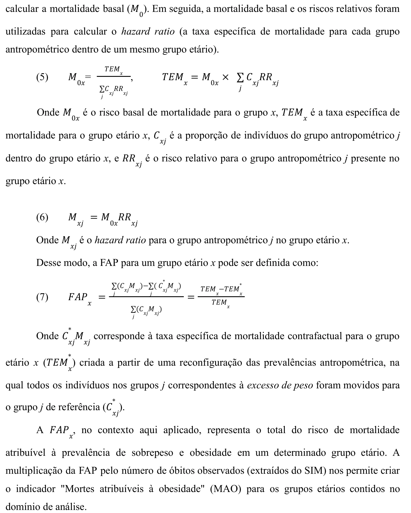</a>
</figure>

A FAP foi limitada numericamente ao intervalo [0,1]. Sua interpretação depende dos pressupostos de causalidade, validade externa dos RR, controle suficiente de confundimento e resposta do risco ao cenário contrafactual.

<figure class="reproducao">
  <a href="assets/documento/equacao-8.webp">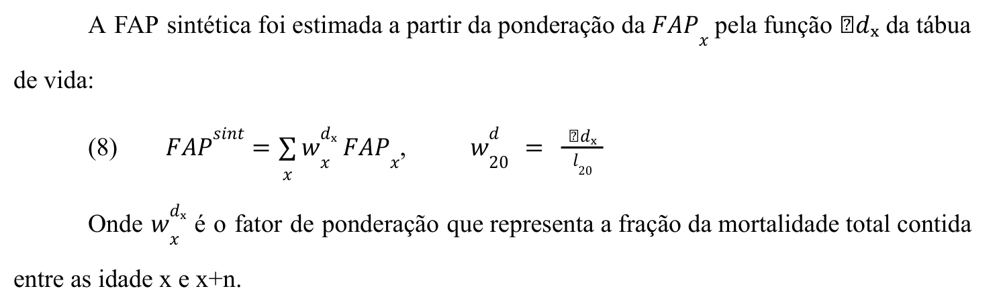</a>
</figure>

<h3>2.2.7 Potencial ganho em expectativa de vida aos 20 anos</h3>

O PGEV20 foi estimada através da subtração da expectativa de vida aos 20 anos observada (e20) pela expectativa de vida contrafactual (e20*). e20* foi obtida através das funções da tábua de vida considerando os riscos de morte contrafactuais (m*ₓ) em um cenário onde toda a população possuía o risco do grupo de referência:

<figure class="reproducao">
  <a href="assets/documento/equacoes-9-10.webp">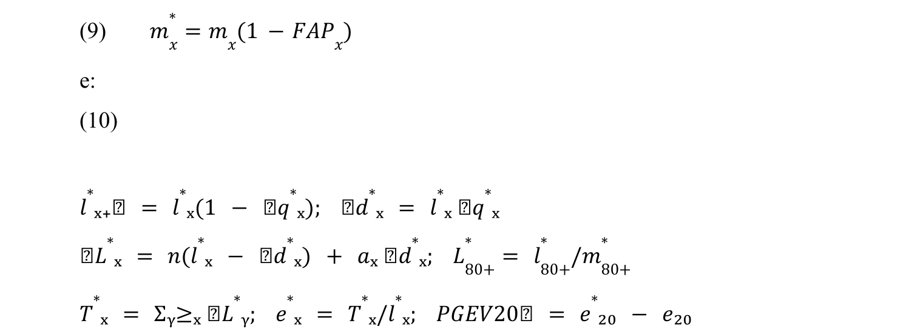</a>
</figure>

O procedimento é análogo às tábuas de causa eliminada, mas o decremento removido corresponde à parcela atribuível a um fator de risco e não a uma causa básica mutuamente exclusiva (Beltrán-Sánchez; Preston; Canudas-Romo, 2008).

<h3>2.2.8 Inferência dos indicadores contrafactuais</h3>

A incerteza dos indicadores contrafactuais foi estimada com 1.000 réplicas do desenho. A POF 2002-2003 e a PNS 2013 utilizaram o bootstrap Rao-Wu-Yue-Beaumont. A POF 2008-2009 e a PNS 2019, que apresentaram estratos com UPA solitária no domínio, utilizaram o bootstrap generalizado de Beaumont e Patak, com estimador de variância por conglomerado último. Na PNS 2019, τ automático foi empregado para manter os fatores das réplicas positivos e ajustar simultaneamente a escala da variância.

Em cada réplica <em>b</em>, a distribuição completa das seis categorias de IMC foi reestimada e

<figure class="reproducao">
  <a href="assets/documento/replicas.webp">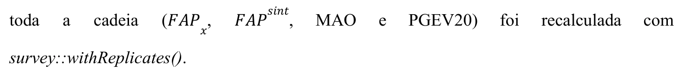</a>
</figure>

A estimativa pontual correspondeu ao cálculo com os pesos da amostra completa. O erro-padrão foi obtido da matriz de variância replicada, com mse=TRUE. Os IC95% corresponderam aos percentis 2,5 e 97,5 das 1.000 estimativas replicadas.

Os indicadores contrafactuais propagam apenas a incerteza das prevalências antropométricas (PNS e POF), os RRs, os óbitos do SIM e as funções das tábuas de vida permaneceram fixos. Não foi realizada comparação com linearização para FAP, MAO ou PGEV20.

<figure class="reproducao">
  <a href="assets/documento/quadro-2.webp">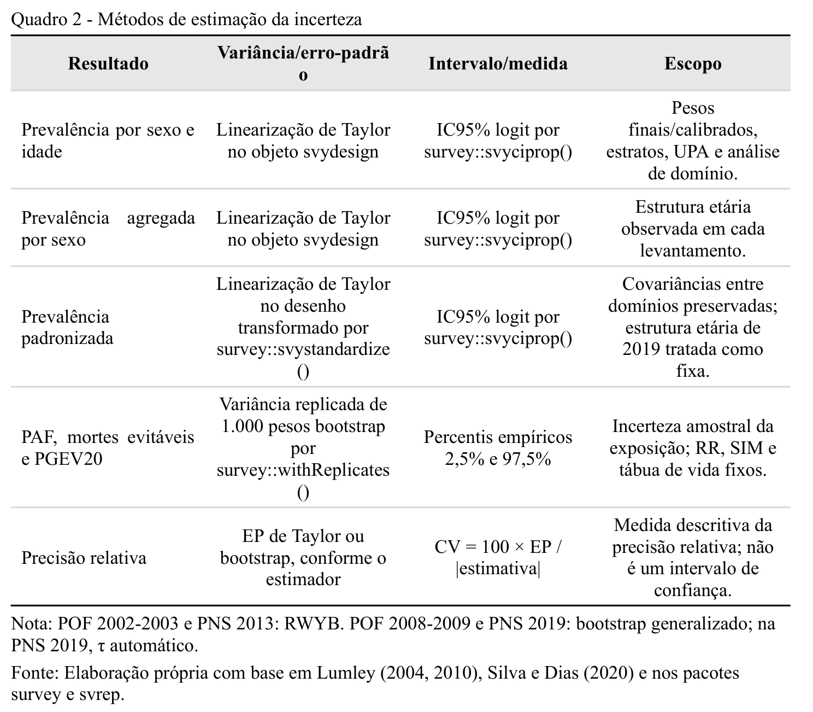</a>
</figure>

<h2>REFERÊNCIAS</h2>

BEAUMONT, J.-F.; PATAK, Z. On the generalized bootstrap for sample surveys with special attention to Poisson sampling. International Statistical Review, v. 80, n. 1, p. 127-148, 2012. DOI: 10.1111/j.1751-5823.2011.00166.x.

BELTRÁN-SÁNCHEZ, H.; PRESTON, S. H.; CANUDAS-ROMO, V. An integrated approach to cause-deleted life tables. Demographic Research, v. 19, art. 35, p. 1323-1350, 2008. DOI: 10.4054/DemRes.2008.19.35.

BRASIL. Ministério da Saúde. Sistema de Informações sobre Mortalidade — SIM. Brasília, DF: Ministério da Saúde. Disponível em: https://www.gov.br/saude/pt-br/composicao/svsa/sistemas-de-informacao/sim. Acesso em: 31 ago. 2026.

DI ANGELANTONIO, Emanuele et al. Body-mass index and all-cause mortality: individual-participant-data meta-analysis of 239 prospective studies in four continents. Lancet, v. 388, n. 10046, p. 776–786, 20 ago. 2016.

IBGE - INSTITUTO BRASILEIRO DE GEOGRAFIA E ESTATÍSTICA. Pesquisa de Orçamentos Familiares 2002-2003: microdados. Rio de Janeiro: IBGE. Disponível em: https://ftp.ibge.gov.br/Orcamentos_Familiares/Pesquisa_de_Orcamentos_Familiares_2002_2003/Microdados/. Acesso em: 31 ago. 2026.

IBGE - INSTITUTO BRASILEIRO DE GEOGRAFIA E ESTATÍSTICA. Pesquisa de Orçamentos Familiares 2008-2009: microdados. Rio de Janeiro: IBGE. Disponível em: https://ftp.ibge.gov.br/Orcamentos_Familiares/Pesquisa_de_Orcamentos_Familiares_2008_2009/Microdados/. Acesso em: 31 ago. 2026.

IBGE - INSTITUTO BRASILEIRO DE GEOGRAFIA E ESTATÍSTICA. Pesquisa Nacional de Saúde 2013: microdados. Rio de Janeiro: IBGE. Disponível em: https://ftp.ibge.gov.br/PNS/2013/Microdados/. Acesso em: 31 ago. 2026.

IBGE - INSTITUTO BRASILEIRO DE GEOGRAFIA E ESTATÍSTICA. Pesquisa Nacional de Saúde 2019: microdados. Rio de Janeiro: IBGE. Disponível em: https://ftp.ibge.gov.br/PNS/2019/Microdados/. Acesso em: 31 ago. 2026.

IBGE — INSTITUTO BRASILEIRO DE GEOGRAFIA E ESTATÍSTICA. Projeções da População do Brasil e Unidades da Federação: revisão 2024. Rio de Janeiro: IBGE, 2024.

IBGE - INSTITUTO BRASILEIRO DE GEOGRAFIA E ESTATÍSTICA. Tábuas Completas de Mortalidade. Rio de Janeiro: IBGE. Disponível em: https://www.ibge.gov.br/estatisticas/sociais/populacao/9126-tabuas-completas-de-mortalidade.html. Acesso em: 31 ago. 2026.

LOBSTEIN, T.; JACKSON-LEACH, R. Workpackage 7: Overweight and Obesity: report on data collection for overweight and obesity prevalence and related relative risks. London: International Association for the Study of Obesity, 2010.

LUMLEY, T. Analysis of complex survey samples. Journal of Statistical Software, v. 9, n. 8, p. 1-19, 2004. DOI: 10.18637/jss.v009.i08.

LUMLEY, T. Complex Surveys: a guide to analysis using R. Hoboken: Wiley, 2010. DOI: 10.1002/9780470580066.

RABACOW, F. M.; AZEREDO, C. M.; REZENDE, L. F. M. Deaths attributable to high body mass in Brazil. Preventing Chronic Disease, v. 16, E141, 2019. DOI: 10.5888/pcd16.190143.

SILVA, P. L. N.; DIAS, A. J. R. Amostragem com R. 2020. Disponível em: https://amostragemcomr.github.io/livro/. Acesso em: 31 ago. 2026.

SOUZA-JÚNIOR, P. R. B. et al. Desenho da amostra da Pesquisa Nacional de Saúde 2013. Epidemiologia e Serviços de Saúde, v. 24, n. 2, p. 207-216, 2015. DOI: 10.5123/S1679-49742015000200003.

STOPA, S. R. et al. Pesquisa Nacional de Saúde 2019: histórico, métodos e perspectivas. Epidemiologia e Serviços de Saúde, v. 29, n. 5, e2020315, 2020. DOI: 10.1590/S1679-49742020000500004.

:::
