::: {.texto-tcc}

<h2>3.1 Prevalências antropométricas</h2>

<h3>3.1.1 Prevalência por sexo e grupo etário</h3>

A estimação das prevalências de sobrepeso (IMC de 25,0 a menos de 30,0 kg/m²), excesso de peso (IMC ≥ 25,0 kg/m²) e obesidade (IMC ≥ 30,0 kg/m²) trouxe um padrão nítido já identificado pela literatura. A prevalência cresce ao longo dos grupos etários e começa a decair no grupo de 60 a 69 anos. O processo de perda de peso nesses grupos é explicado na literatura pela perda de massa muscular (sarcopenia), de massa mineral óssea e pela redução de água corporal (Tavares et al., 2015). Conforme descrito na metodologia, foram aplicados os mesmos parâmetros de classificação dos grupos de IMC para todas as faixas etárias - prática não consensual nos estudos de nutrição. Caso tivéssemos optado por outro parâmetro de categorização para a população idosa, a queda seria ainda mais acentuada.

As prevalências de excesso de peso e obesidade mostraram crescimento sistemático em quase todos os grupos etários observados, para ambos os sexos. No entanto, o grupo sobrepeso (IMC estritamente entre 25,0 e menos de 30,0 kg/m²) não apresentou o mesmo padrão, trazendo, inclusive, um ponto de quase perfeita confluência para o grupo de mulheres entre 50 e 59 anos (Figura 1). Isso pode ser compreendido, do ponto de vista populacional, como resultado de uma &quot;matriz probabilística&quot;, na qual o grupo sobrepeso &quot;perdeu&quot; tantas pessoas quanto &quot;recebeu&quot;. Uma hipótese diante desse resultado seria que o principal &quot;fluxo&quot; relacionado a esse grupo, em números absolutos, foi normal→sobrepeso e sobrepeso→obesidade, sendo pouco significativo o resultado desse balanço na série histórica estudada. Diante das transformações conjunturais relacionadas a novos produtos medicamentosos destinados ao tratamento da obesidade, uma possível hipótese seria esperar o crescimento do fluxo obesidade→sobrepeso, ao menos para alguns subgrupos da população. Nesse sentido, o crescimento do sobrepeso, sobretudo na faixa etária de 50 a 59 anos, poderia ser um estimador indireto do impacto efetivo desses produtos sobre o conjunto da população.

No que diz respeito à diferença entre os sexos (Figura 2), os homens apresentaram maior prevalência de sobrepeso, principalmente entre 20 e 59 anos, com pico dessa diferença entre 30 e 39 anos; já as mulheres apresentaram maior prevalência de obesidade em todos os grupos etários, sendo essa diferença mais acentuada nas idades acima de 40 anos. O comparativo do excesso de peso (IMC ≥ 25,0 kg/m²) evidencia a resultante dessa dinâmica, com maior prevalência entre os homens nas idades mais jovens e entre as mulheres nas idades mais avançadas. Por questões relacionadas ao tamanho amostral da PNS 2019, os resultados mensurados são pouco precisos e inconsistentes nesse ano para a análise proposta. Por esse motivo, é difícil apontar, com as fontes de dados aqui utilizadas, o que ocorreu com a evolução do indicador após 2013.

<figure class="resultado-figura"><figcaption>Figura 1 - Prevalências antropométricas por idade e sexo, Brasil, 2003-2019</figcaption>
  <a href="assets/figuras/figura-1.webp">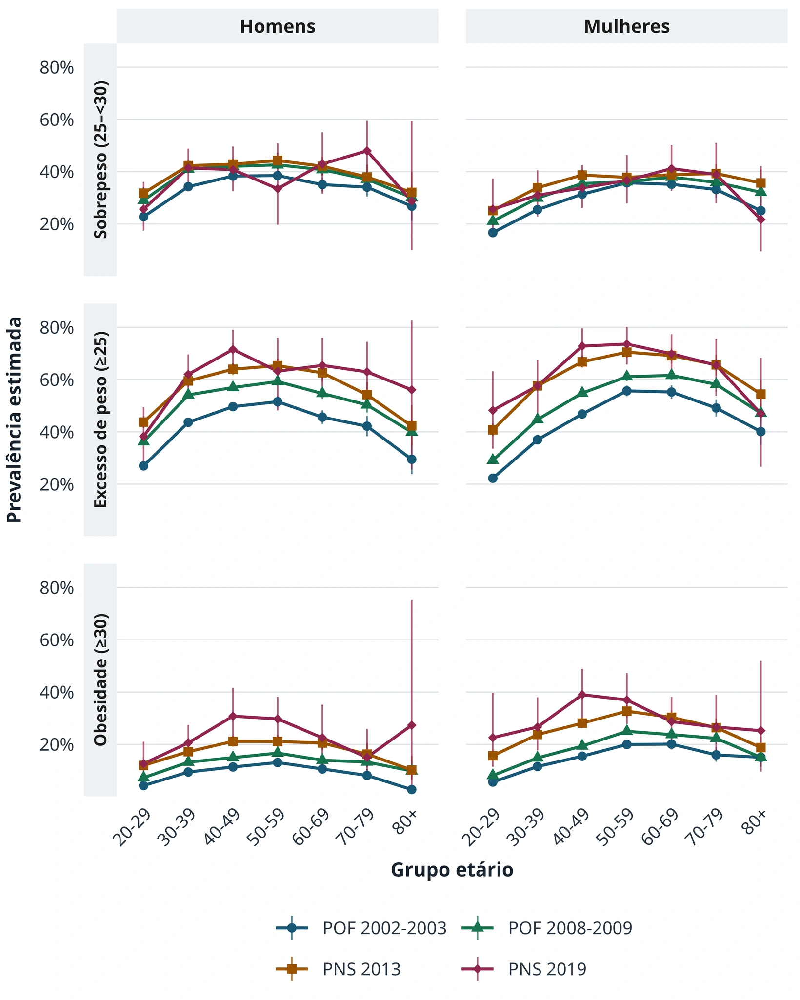</a>
  
Nota: Sobrepeso = 25 ≤ IMC &lt; 30 kg/m²; excesso de peso = IMC ≥25 kg/m², incluindo obesidade; obesidade = IMC ≥30 kg/m². IC95% por linearização de Taylor e transformação logit. Fonte: IBGE, POF 2002-2003 e 2008-2009; IBGE, PNS 2013 e 2019. Elaboração própria.

</figure>

<figure class="resultado-figura"><figcaption>Figura 2 - Diferença das prevalências antropométricas por sexo, Brasil, 2003-2019</figcaption>
  <a href="assets/figuras/figura-2.webp">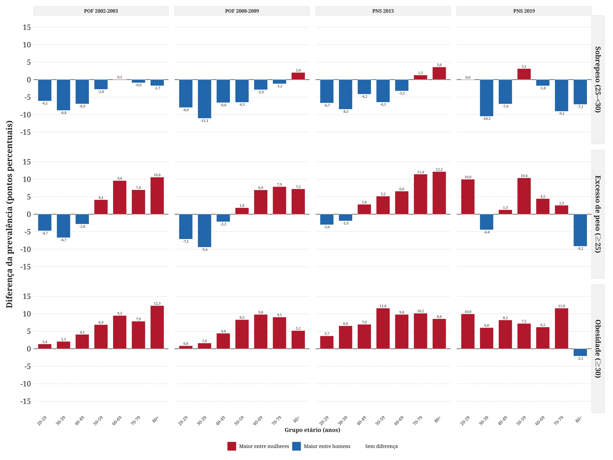</a>
  
Nota: Valores positivos indicam maior prevalência entre mulheres; valores negativos, maior prevalência entre homens. Diferenças descritivas, sem teste de hipótese. Fonte: IBGE, POF 2002-2003 e 2008-2009; IBGE, PNS 2013 e 2019. Elaboração própria.

</figure>

<h3>3.1.2 Prevalência por sexo</h3>

Em nível populacional, as prevalências totais estimadas são médias ponderadas dos resultados de cada grupo etário, considerando-se a estrutura etária. Como visto anteriormente, existem diversas relações entre idade e prevalências antropométricas. Por esse motivo, padronizamos os resultados utilizando como referência a estrutura etária da população brasileira de 2019, o que possibilita maior comparabilidade entre os anos.

As menores diferenças observadas ocorreram no grupo de sobrepeso, cuja prevalência passou de 27,8% (27,1-28,5) em 2003 para 32,6% (29,1-36,2) em 2019. Isso representa uma diferença estatisticamente significativa e um crescimento de aproximadamente 4,8 pontos percentuais no período. Para os homens, há sobreposição dos intervalos de confiança no período, e a diferença entre as estimativas pontuais é de aproximadamente 3,7 pontos percentuais.

Em termos de prevalência por grupo, o maior crescimento ocorreu, evidentemente, no excesso de peso, que, em síntese, agrega o crescimento observado tanto para sobrepeso quanto para obesidade. Entre as mulheres, a prevalência de excesso de peso passou de 41,3% (40,5-42,1) em 2003 para 62,5% (58,4-66,4) em 2019, totalizando crescimento de aproximadamente 21,2 pontos percentuais no período. Para os homens, esse crescimento foi de aproximadamente 17 pontos percentuais.

A prevalência de obesidade entre as mulheres passou de 13,6% (13,0-14,1) em 2003 para 29,9% (25,2-35,1) em 2019, totalizando aumento de aproximadamente 120% nas estimativas pontuais. Para os homens, a prevalência passou de 9,0% (8,6-9,5) em 2003 para 22,3% (19,5-25,3) em 2019, o que corresponde a aumento de aproximadamente 148% nas estimativas pontuais.

<figure class="resultado-figura"><figcaption>Figura 3 - Evolução das prevalências antropométricas padronizadas por idade</figcaption>
  <a href="assets/figuras/figura-3.webp">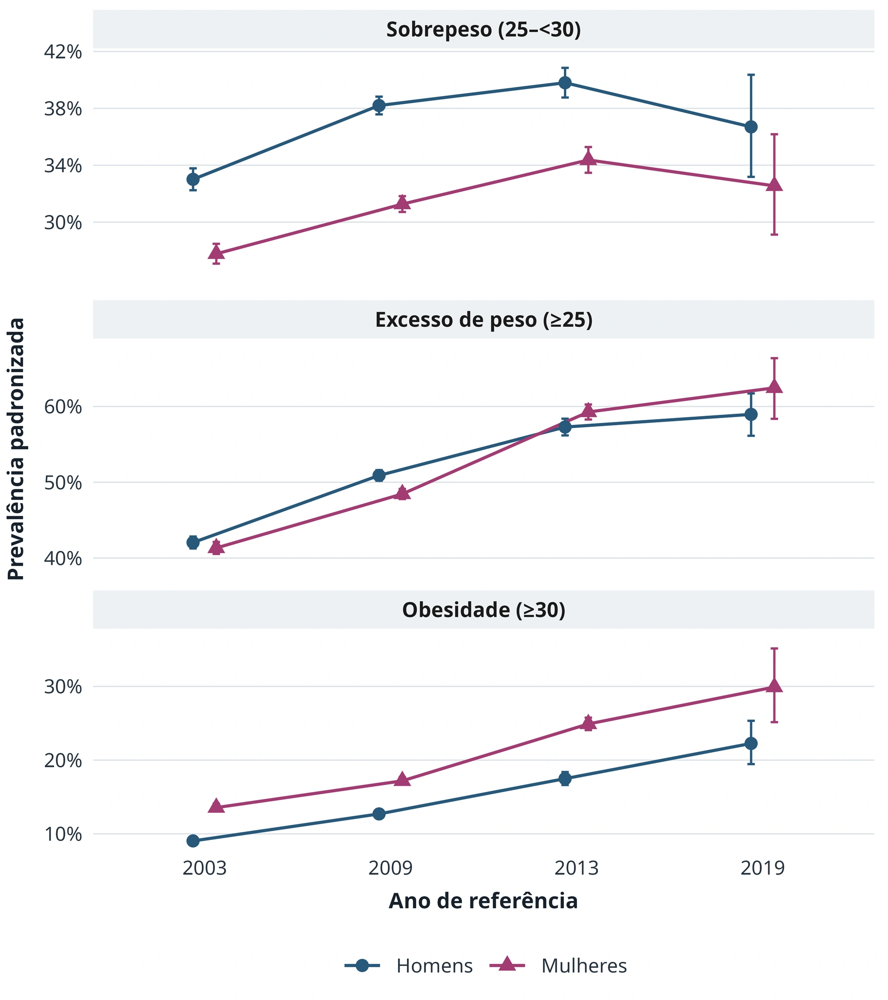</a>
  
Nota: Padrão formado pela população brasileira de ambos os sexos em 2019; padronização direta com survey::svystandardize(). Fonte: IBGE, POF 2002-2003 e 2008-2009; IBGE, PNS 2013 e 2019; IBGE, Projeções da População, revisão 2024. Elaboração própria.

</figure>

<figure class="reproducao">
  <a href="assets/documento/tabela-4.webp">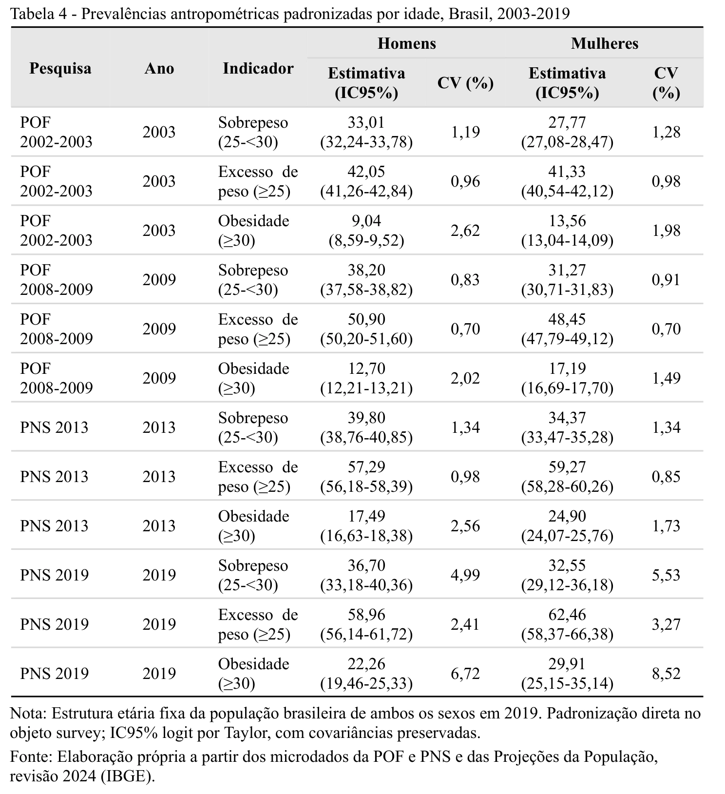</a>
</figure>

<h2>3.2 Análise contrafactual</h2>

Os resultados contrafactuais aqui estimados exigem um alto grau de cuidado interpretativo, pois estão intrinsecamente atrelados a uma série de pressupostos e limitações. Apesar de termos uma coerência metodológica em aplicar diferentes valores de RR para homens e mulheres, considerando também os grupos etários, as medidas de RR utilizadas remetem ao ano de 2007, e as pesquisas que originaram esses parâmetros foram todas conduzidas em contextos não brasileiros (Lobstein e Jackson-Leach, 2010). Avanços técnico-farmacêuticos que possibilitaram o maior controle sobre quadros clínicos, e o avanço da prevalência de obesidade são alguns exemplos de fatores que podem ter influenciado na mudança da desigualdade de exposição ao risco de mortalidade (RR) nos últimos anos. Para além disso, as mensurações aqui realizadas consideram a incerteza apenas para as prevalências antropométricas (POF, PNS), as demais fontes de dados são consideradas apenas em seus valores centrais; os intervalos de confiança forma gerados através de métodos computacionais de bootstrap, e não possibilitam realizar inferências estatísticas; por fim, a diminuição amostral da PNS 2019 impactou todos os indicadores aqui estimados para o respectivo ano. Diante desse quadro analítico, veremos ao longo dessa seção: possíveis interpretações dos resultados; como eles podem nos ajudar a compreender a relação entre obesidade e mortalidade; e caminhos para uma estimação mais precisa e coerente.

<h3>3.2.1 Fração atribuível populacional</h3>

Para interpretar a FAP por grupo etário, deve-se considerar os elementos por trás dessa medida: os Riscos Relativos e as prevalências antropométricas. A desigualdade na exposição aos riscos de mortalidade entre os grupos antropométricos, conforme apresentado (Tabela 2), reduz nas idades mais avançadas, e também estão relacionadas a uma maior penalidade para os grupos masculinos, a prevalência de<em> sobrepeso</em> aos homens, ao passo que a prevalência de <em>obesidade</em> esteve mais associado às mulheres, e o diferencial entre os sexos para<em> excesso de </em> <em>peso</em> mostrou uma inversão a partir dos grupos etários acima de 50 anos, passando a penalizar mais as mulheres. Esses foram os elementos responsáveis pela diferença de sexo por trás da estimação da FAP. No que se refere a evolução do indicador para cada sexo ao longo do período observado, ela simplesmente reflete o aumento da prevalência para os grupos de <em>sobrepeso</em> e<em> obesidade</em>, visto que os valores de RR aplicados foram os mesmos para todos os anos3.

3 Os resultados completos podem ser consultados no Anexo 1 deste trabalho.

<figure class="resultado-figura"><figcaption>Figura 5 - Fração Atribuível Populacional por idade e sexo</figcaption>
  <a href="assets/figuras/figura-5.webp">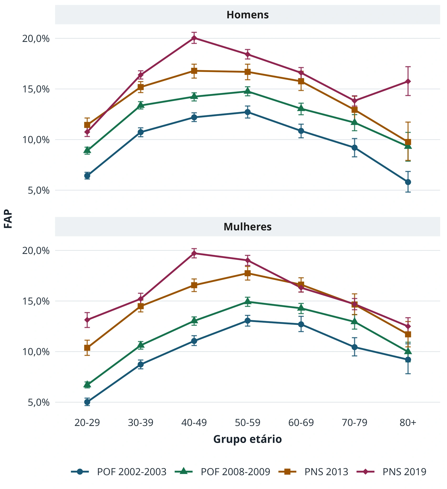</a>
  
Nota: Cenário de eliminação do IMC ≥25 kg/m²; RR centrais por sexo e idade; IC95% por 1.000 réplicas bootstrap. Fonte: IBGE, POF 2002-2003 e 2008-2009; IBGE, PNS 2013 e 2019; DYNAMO-HIA (Lobstein; Jackson-Leach, 2010). Elaboração própria.

</figure>

Para a <em>FAP sintética,</em> a diferença observada para os sexos é baixa, quando comparada com a diferença na prevalência. Visto que a modelagem aqui realizada não incorpora à &quot;causa de morte&quot;, contornaremos esse aspecto de modo a apenas jogar luz sobre os resultados estimados. A proximidade da <em>FAP sintética</em> pode, assim, ser explicada pelo: maior RR para os grupos do sexo masculino e pela “coincidência” entre as idades com maior prevalência de <em>obesidade</em> (40-70 anos) e o número de óbitos neste intervalo etário, visto que o número de óbitos está por trás do fator de ponderação para a <em>FAP sintética</em>. De modo inverso, as mulheres, apesar de terem uma maior prevalência de<em> obesidade</em> em todas as idades observadas, e de<em> excesso de peso</em> a partir dos 50 anos, seriam &quot;menos penalizadas&quot; do ponto de vista da mortalidade, pois, para além dos riscos relativos serem menores, a maior partes dos óbitos femininos (o fator de ponderação da FAP) se encontram nas idades onde já é possível observar uma queda na prevalência de<em> obesidade</em> para este grupo. A leitura apresentada não considera os impactos da<em> obesidade</em> na morbidade e na qualidade de vida, sendo esta uma outra face da discussão. Do ponto de vista da morbidade, as mulheres estariam sendo mais penalizadas não só pela maior prevalência, mas também pelo maior tempo vivido com obesidade e seus agravantes. Considerando todas as ressalvas e implicações da dinâmica demográfica, a FAP estimada representa a fração do risco de mortalidade, ou do número de óbitos observados, que esteve relacionado com o fator observado. Nos anos de 2013 e 2019, ele esteve associado a mais de 10% do risco de mortalidade para ambos os sexos e para quase todos os grupos etários. Seus valores sintéticos para a população saíram de 10,18% (9,44-11,06) em 2002, e chegaram a 13,79% (13,26-14,29) para as mulheres; para os homens, essa mudança foi de 8,79% (8,34-9,26) em 2002, para 15,70% (15,05-16,37) em 2019.

<figure class="reproducao">
  <a href="assets/documento/tabela-7.webp">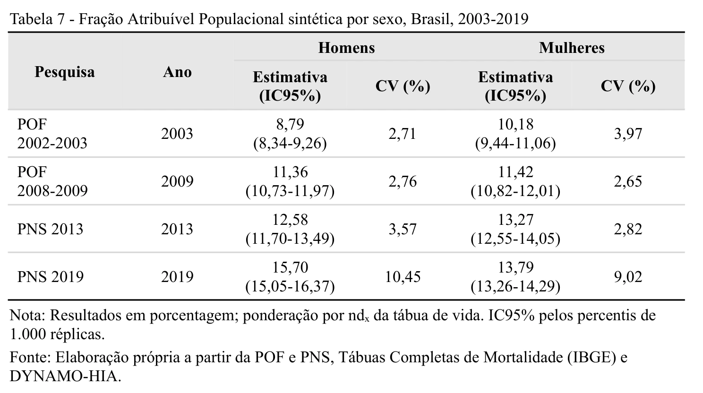</a>
</figure>

<figure class="resultado-figura"><figcaption>Figura 6 - Evolução da Fração Atribuível Populacional sintética</figcaption>
  <a href="assets/figuras/figura-6.webp">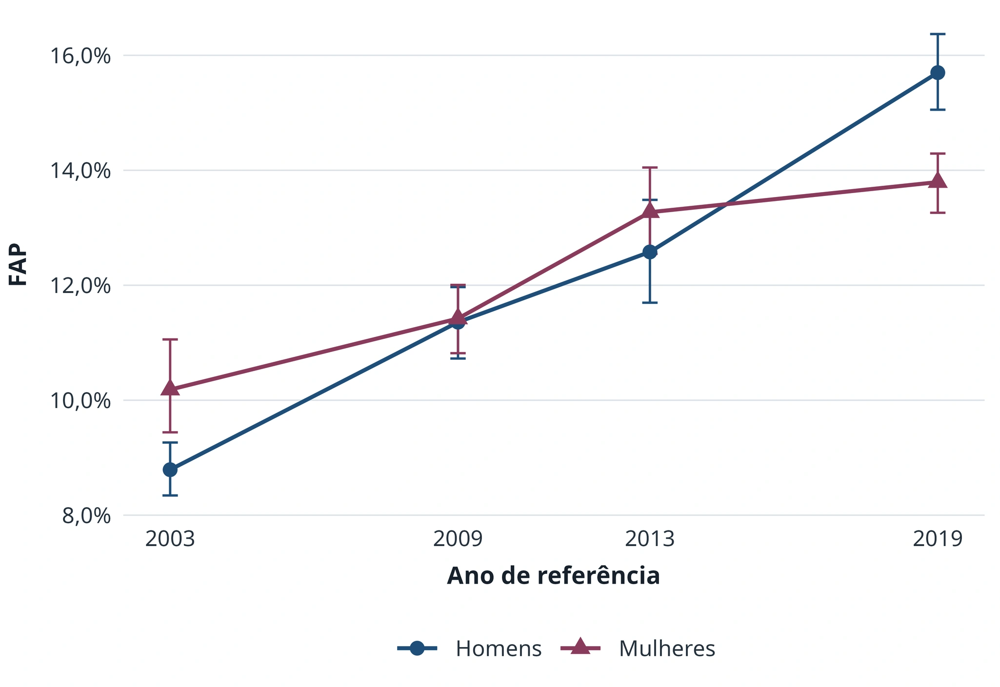</a>
  
Nota: Ponderação pela distribuição de óbitos ndₓ da tábua de vida de cada ano; IC95% bootstrap. Fonte: IBGE, POF e PNS; IBGE, Tábuas Completas de Mortalidade; DYNAMO-HIA (Lobstein; Jackson-Leach, 2010). Elaboração própria.

</figure>

<h3>3.2.2 Número de mortes evitáveis</h3>

O número absoluto de mortes evitáveis, ou de mortes associadas à obesidade, como descrito na seção metodológica, foi mensurado a partir da multiplicação da FAP pelo número de mortes registradas dentro de um respectivo grupo etário. Ou seja, esse indicador relaciona as prevalências antropométricas e correspondentes riscos específicos (captados pela FAP) com o padrão da curva de mortalidade. Por essa razão, os resultados são maiores para os grupos masculinos em todos os períodos analisados, visto que as maiores FAPs “coincidem” com os momentos mais acentuados da curva de mortalidade masculina. Esse resultado expressa o padrão de mortalidade masculina associado à causa de morte, no qual, entre 40 e 70 anos, a causa de morte para esse grupo está fortemente associada à doenças cardiovasculares. Os diferenciais entre o número de mortes associadas à obesidade entre esses grupos etários pode ser, em alguma medida, um indicador para o &quot;efeito protetivo&quot; do gênero sobre riscos específicos de mortalidade. Esta proteção contra o risco, conforme apresentado anteriormente, traz uma contrapartida: o maior tempo de vida em condições piores de saúde no que tange os indicadores de prevalência antropométricos. Outro ponto significativo de diferenciação entre as curvas para homens e mulheres são os resultados estimados para as idades mais avançadas (80+). Neste grupo, com exceção dos dados de baixa precisão para a PNS de 2019, há uma queda do número de mortes associadas à obesidade entre os homens, e um aumento para as mulheres. Do ponto de vista do risco, a desigualdade na exposição entre os grupos tende a cair para essas faixas etárias (Global BMI Mortality Collaboration et al., 2016; Singh et al., 2013; Yi et al., 2015), no entanto, por concentrarem um número muito significativo de óbitos femininos, o grupo 80+ consistiu na maior fonte de MRO para as mulheres.

<figure class="resultado-figura"><figcaption>Figura 7 - Número absoluto de mortes evitáveis por idade e sexo</figcaption>
  <a href="assets/figuras/figura-7.webp">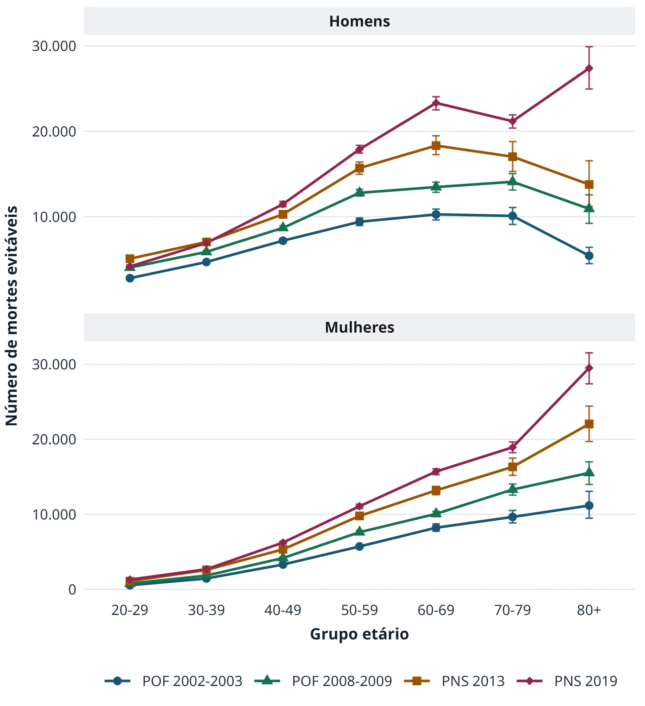</a>
  
Nota: PAF da célula multiplicada pelos óbitos do SIM na mesma célula; IC95% bootstrap. Fonte: IBGE, POF e PNS; SIM, óbitos por ocorrência; DYNAMO-HIA (Lobstein; Jackson-Leach, 2010). Elaboração própria.

</figure>

<figure class="reproducao">
  <a href="assets/documento/tabela-9.webp">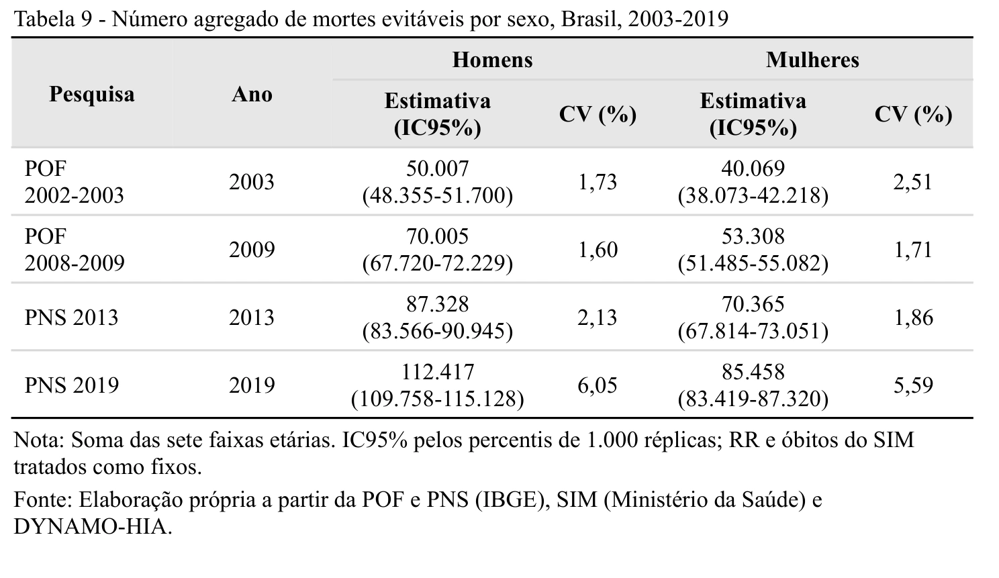</a>
</figure>

<figure class="resultado-figura"><figcaption>Figura 8 - Evolução do número absoluto de mortes evitáveis</figcaption>
  <a href="assets/figuras/figura-8.webp">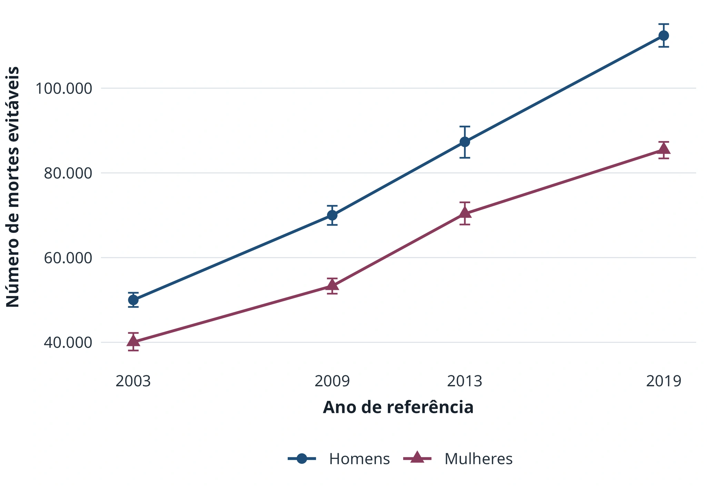</a>
  
Nota: População de 20 anos ou mais; IC95% bootstrap. Fonte: IBGE, POF e PNS; SIM, óbitos por ocorrência; DYNAMO-HIA (Lobstein; Jackson-Leach, 2010). Elaboração própria.

</figure>

<h3>3.2.3 Potencial ganho em expectativa de vida aos 20 anos</h3>

Os Potencias Ganhos em Expectativa de vida podem ser considerados aqui como o indicador sintético com maior interpretação demográfica, pois traz consigo os elementos de composição e risco (captados pela FAP), do número de mortes associadas à obesidade e da idade onde essas mortes ocorreram. Aqui os resultados estimados estiveram muito próximos, ou indiferente estatisticamente, entre os sexos (com exceção da PNS 2019, causada pela alta variância nas idades masculinas mais avançadas), essa proximidade é causada por dois fatores que se balanceiam: 1. A maior prevalência de<em> excesso de peso</em> até os 49 anos e de<em> sobrepeso</em> até os 69, em interação com as altas taxas de mortalidade nestas faixas etárias para os homens, gera ganhos muito significativos no resultado agregado, visto que quanto mais jovem a vida salva, maior o ganho potencial para expectativa de vida 2. O segundo fator diz respeito a incomparabilidade desse indicador entre os sexos. Na medida em que cada grupo traz, de início, uma expectativa de vida própria, caso seja de interesse a comparabilidade entre sexos, é necessários criar uma novo indicador que capte o &quot;ganho relativo&quot; para cada um dos grupos.

<figure class="resultado-figura"><figcaption>Figura 9 - Evolução do potencial ganho em expectativa de vida aos 20 anos</figcaption>
  <a href="assets/figuras/figura-9.webp">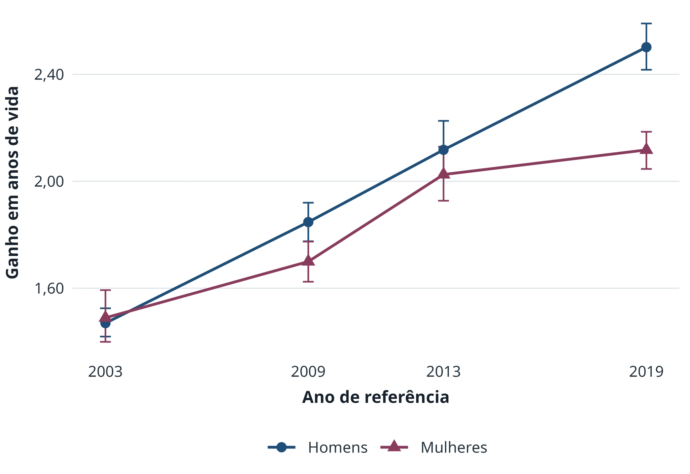</a>
  
Nota: Cenário de eliminação do IMC ≥25 kg/m²; IC95% bootstrap. Fonte: IBGE, POF e PNS; IBGE, Tábuas Completas de Mortalidade; DYNAMO-HIA (Lobstein; Jackson-Leach, 2010). Elaboração própria.

</figure>

<figure class="reproducao">
  <a href="assets/documento/tabela-10.webp">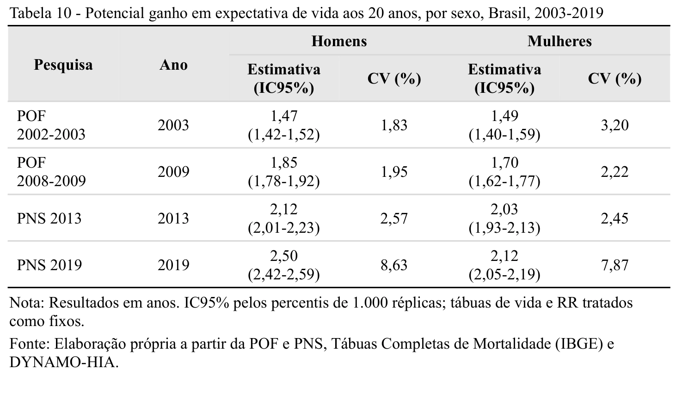</a>
</figure>

<h2>REFERÊNCIAS</h2>

BRASIL. Ministério da Saúde. Sistema de Informações sobre Mortalidade — SIM. Brasília, DF: Ministério da Saúde. Disponível em: https://www.gov.br/saude/pt-br/composicao/svsa/sistemas-de-informacao/sim. Acesso em: 31 ago. 2026.

DI ANGELANTONIO, Emanuele et al. Body-mass index and all-cause mortality: individual-participant-data meta-analysis of 239 prospective studies in four continents. Lancet, v. 388, n. 10046, p. 776–786, 20 ago. 2016.

IBGE - INSTITUTO BRASILEIRO DE GEOGRAFIA E ESTATÍSTICA. Pesquisa de Orçamentos Familiares 2002-2003: microdados. Rio de Janeiro: IBGE. Disponível em: https://ftp.ibge.gov.br/Orcamentos_Familiares/Pesquisa_de_Orcamentos_Familiares_2002_2003/Microdados/. Acesso em: 31 ago. 2026.

IBGE - INSTITUTO BRASILEIRO DE GEOGRAFIA E ESTATÍSTICA. Pesquisa de Orçamentos Familiares 2008-2009: microdados. Rio de Janeiro: IBGE. Disponível em: https://ftp.ibge.gov.br/Orcamentos_Familiares/Pesquisa_de_Orcamentos_Familiares_2008_2009/Microdados/. Acesso em: 31 ago. 2026.

IBGE - INSTITUTO BRASILEIRO DE GEOGRAFIA E ESTATÍSTICA. Pesquisa Nacional de Saúde 2013: microdados. Rio de Janeiro: IBGE. Disponível em: https://ftp.ibge.gov.br/PNS/2013/Microdados/. Acesso em: 31 ago. 2026.

IBGE - INSTITUTO BRASILEIRO DE GEOGRAFIA E ESTATÍSTICA. Pesquisa Nacional de Saúde 2019: microdados. Rio de Janeiro: IBGE. Disponível em: https://ftp.ibge.gov.br/PNS/2019/Microdados/. Acesso em: 31 ago. 2026.

IBGE — INSTITUTO BRASILEIRO DE GEOGRAFIA E ESTATÍSTICA. Projeções da População do Brasil e Unidades da Federação: revisão 2024. Rio de Janeiro: IBGE, 2024.

IBGE - INSTITUTO BRASILEIRO DE GEOGRAFIA E ESTATÍSTICA. Tábuas Completas de Mortalidade. Rio de Janeiro: IBGE. Disponível em: https://www.ibge.gov.br/estatisticas/sociais/populacao/9126-tabuas-completas-de-mortalidade.html. Acesso em: 31 ago. 2026.

LOBSTEIN, T.; JACKSON-LEACH, R. Workpackage 7: Overweight and Obesity: report on data collection for overweight and obesity prevalence and related relative risks. London: International Association for the Study of Obesity, 2010.

YI, S.-W.; OHRR, H.; SHIN, S.-A.; YI, J.-J. Sex-age-specific association of body mass index with all-cause mortality among 12.8 million Korean adults: a prospective cohort study. International Journal of Epidemiology, v. 44, n. 5, p. 1696-1705, 2015. DOI: 10.1093/ije/dyv138.

:::
